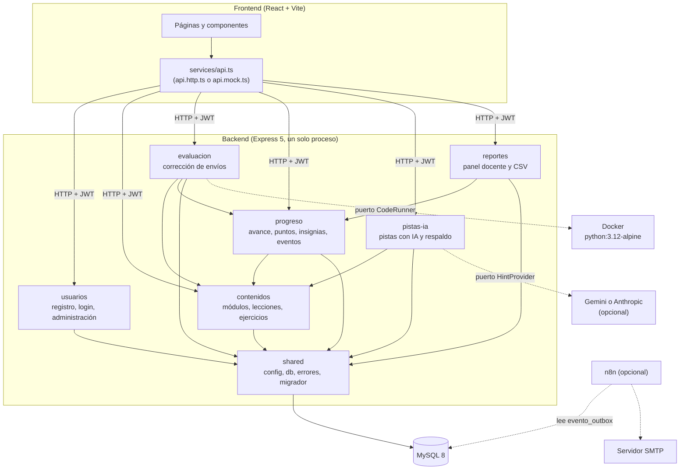
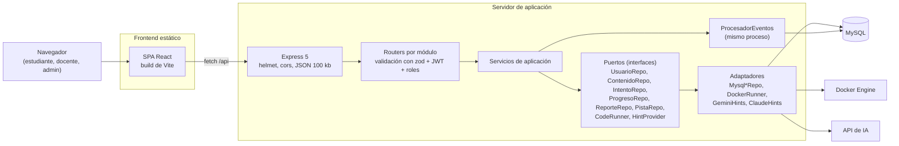
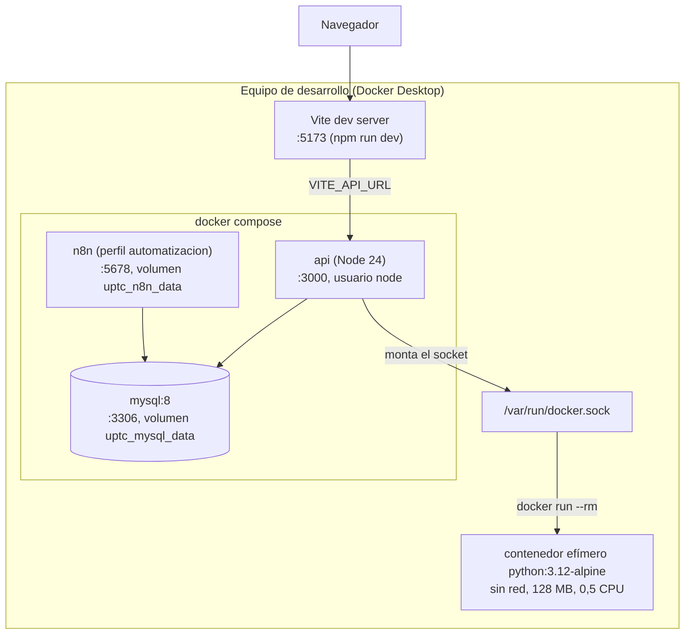
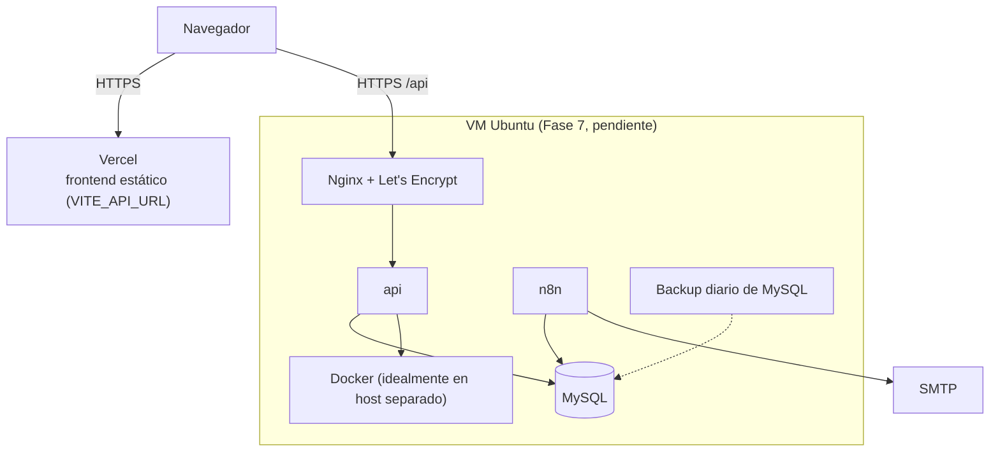
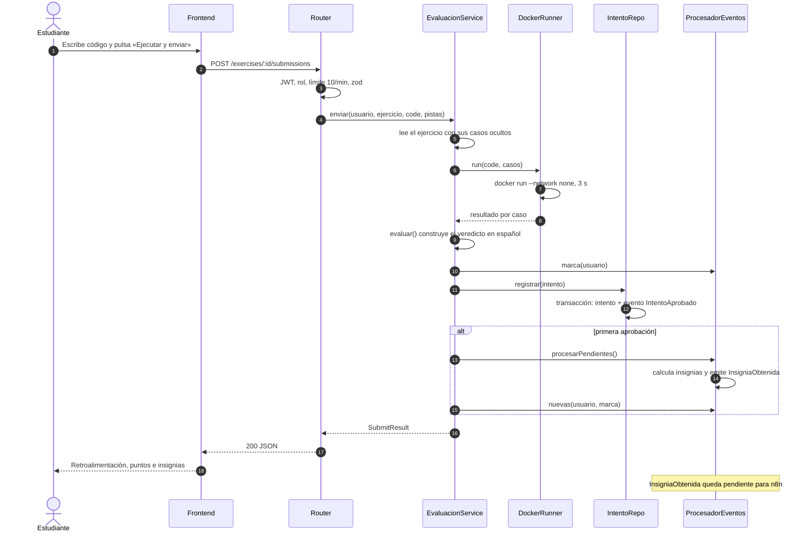
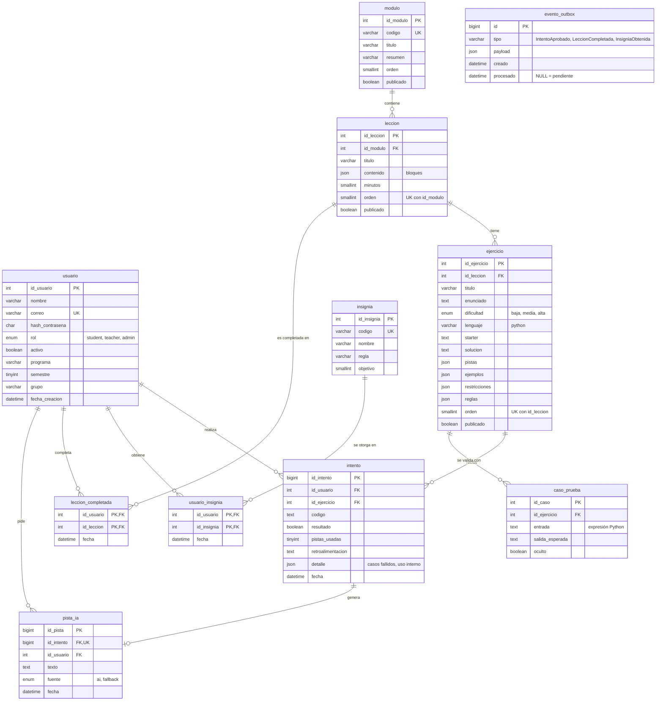
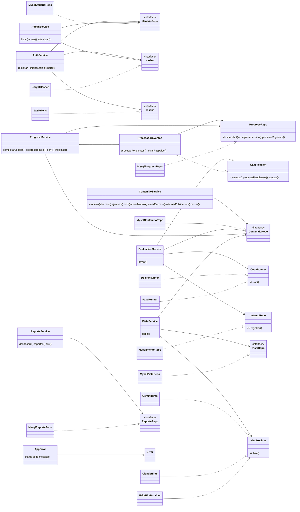

# Diagramas (Mermaid)

Fuente para rehacer las figuras del documento IW: **Fig. 1** (descomposición modular), **Fig. 2** (MER físico), **Fig. 4** (clases del dominio) y **Fig. 6** (despliegue), más el diagrama de componentes y la secuencia del envío de un ejercicio. Todos están dibujados a partir del código real (`backend/src`, `backend/db/migrations`, `docker-compose.yml`).

Cómo verlos: GitHub y la mayoría de editores (VS Code con la extensión «Markdown Preview Mermaid Support») los dibujan directamente. Para exportar una figura como imagen: pegar el bloque en <https://mermaid.live> y descargar SVG o PNG. También salen dibujados en `manual-programador.pdf`.

> **Pendiente (equipo):** exportar las figuras e insertarlas en el documento IW con el estilo y la numeración que pida el docente. Si alguna figura pide más detalle (por ejemplo, todos los atributos del MER), ampliar el bloque correspondiente.

## Fig. 1. Descomposición modular (monolito modular hexagonal)

Cada módulo del backend tiene tres capas: `domain` (reglas y puertos, sin dependencias de infraestructura), `application` (casos de uso) e `infrastructure` (rutas HTTP, MySQL y adaptadores externos). Las flechas indican «usa».

## Componentes

## Fig. 6. Despliegue

Lo que existe hoy es el entorno de desarrollo con `docker compose`. El despliegue en la VM (Nginx con TLS, backups, Vercel apuntando a la API) llega en la Fase 7: la segunda figura es el objetivo, no algo ya instalado.

## Secuencia: envío de un ejercicio (con outbox)

`POST /api/exercises/:id/submissions`. El intento y el evento `IntentoAprobado` se guardan en **una sola transacción**; después, el procesador del mismo proceso consume el evento (y un temporizador lo hace de respaldo si el proceso cayó entre el commit y la llamada).

## Fig. 2. Modelo entidad-relación físico (MySQL 8)

Atributos principales; el detalle completo de columnas está en `backend/db/migrations/`. `evento_outbox` no tiene claves foráneas: su `payload` JSON referencia usuarios y ejercicios por id. La vista `v_progreso` (intentos y ejercicios resueltos por usuario y módulo) no se dibuja.

## Fig. 4. Clases del dominio (puertos y servicios)

Se muestran los puertos (interfaces del dominio), los servicios de aplicación y los adaptadores. Las funciones puras del dominio (`evaluar`, reglas de insignias, `armarProgreso`) no son clases y no se dibujan aquí.

