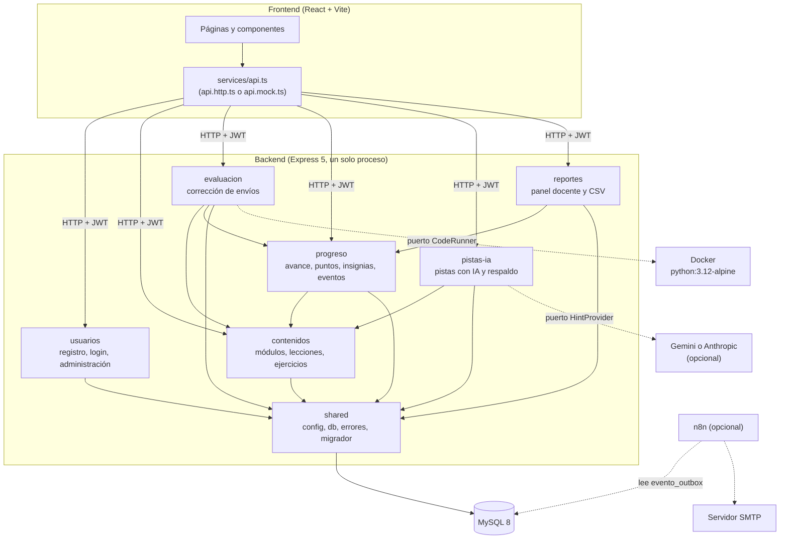
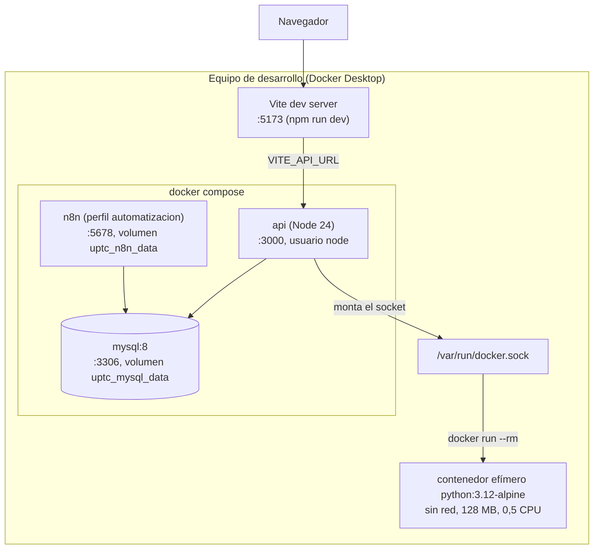
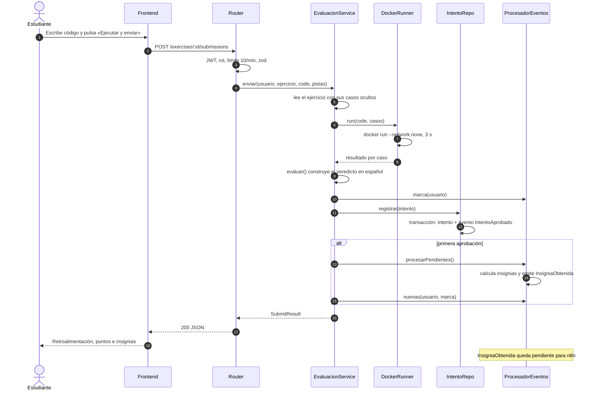
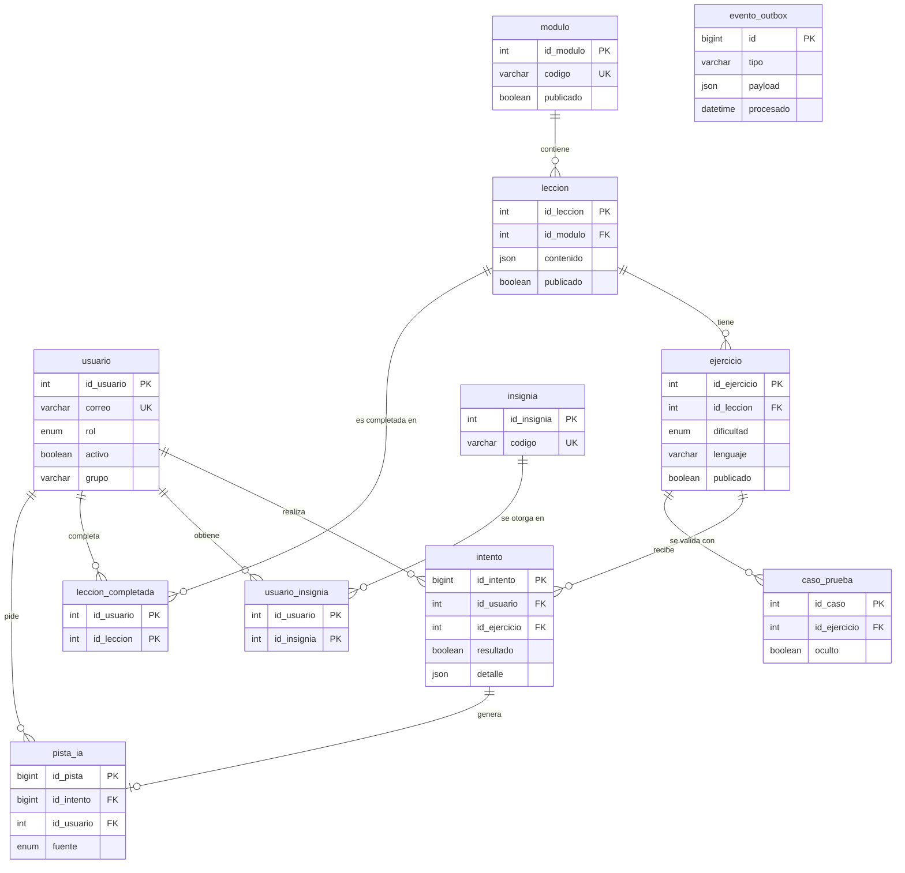

# Manual del programador

Plataforma educativa «Lógica UPTC»: práctica de programación básica con corrección automática. Este manual explica cómo está construida, cómo levantarla en tu equipo y cómo extenderla. Corresponde a la sección 9.7 del documento IW.

Todo lo que aparece aquí se comprobó contra el código del repositorio (rama `feat/fase-6`). Cuando algo falta o no está probado se dice expresamente.

## 1. Visión general

La plataforma tiene tres roles (estudiante, docente y administrador) y cubre estos requisitos:

| Requisito | Dónde está |
|---|---|
| RF-01 acceso y cuentas | módulo `usuarios` |
| RF-02 contenidos (módulos, lecciones, ejercicios) | módulo `contenidos` |
| RF-03 ejercicios con corrección automática | módulo `evaluacion` |
| RF-04 progreso | módulo `progreso` |
| RF-05 gamificación (puntos e insignias) | módulo `progreso` |
| RF-06 reportes del docente | módulo `reportes` |
| RF-07 administración de usuarios | módulo `usuarios` (`/admin/users`) |
| Pistas con IA (opcional) | módulo `pistas-ia` |

Se compone de:

- **Frontend** (`frontend/`): aplicación de una sola página con React, TypeScript y Vite. Funciona en dos modos: *demostración* (datos locales, sin servidor) y *API* (habla con el backend).
- **Backend** (`backend/`): API REST con Express 5 y TypeScript sobre MySQL 8. Es un **monolito modular** con arquitectura hexagonal: cada módulo separa `domain`, `application` e `infrastructure`.
- **Motor de corrección**: cada envío se ejecuta en un contenedor Docker efímero de Python, sin red y con límites de recursos.
- **Automatizaciones** (`n8n/`): dos workflows opcionales de correo (insignia obtenida y resumen semanal).
- **Pruebas y evidencias** (`e2e/`, `perf/`, `scripts/`, `docs/evidencias/`).

## 2. Arquitectura

### 2.1 Componentes y módulos



Las flechas continuas son dependencias de código; las punteadas, integraciones externas detrás de un **puerto** (interfaz del dominio) con su **adaptador** en `infrastructure`.

Regla de dependencia: `domain` no importa nada de `infrastructure`; `application` solo conoce los puertos; las rutas (`infrastructure/routes.ts`) arman los servicios con sus adaptadores. Así el motor de corrección, el proveedor de IA y la base de datos se pueden cambiar o simular en pruebas (`FakeRunner`, `FakeHintProvider`) sin tocar las reglas.

### 2.2 Despliegue

El entorno de desarrollo usa `docker compose` (la API y MySQL en contenedores; el frontend con `npm run dev` en el equipo). El despliegue en una VM está definido en `deploy/` (sección 16).



> **Riesgo conocido:** la API monta `/var/run/docker.sock` para lanzar los contenedores de corrección. Quien comprometa el proceso de la API podría controlar el Docker del equipo. Mitigaciones aplicadas y recomendaciones para producción en la sección 12 y en `docs/BITACORA.md` (Fase 3).

### 2.3 Secuencia: envío de un ejercicio (con outbox)

`POST /api/exercises/:id/submissions`. El intento y el evento `IntentoAprobado` se guardan en **una sola transacción** (patrón *outbox*); después el procesador del mismo proceso consume el evento. Si el proceso cayera entre el commit y esa llamada, un temporizador (cada `OUTBOX_INTERVAL_MS`, 30 s) y el arranque lo retoman.



### 2.4 Modelo de datos (MER)



Versión completa con todos los atributos, el diagrama de clases y el de despliegue de producción: [`docs/diagramas.md`](../diagramas.md).

## 3. Stack y versiones

Versiones instaladas en este repositorio (de los `package.json` y `package-lock.json`):

| Capa | Tecnología | Versión |
|---|---|---|
| Entorno | Node.js | 24 (`engines` del backend: `>=24`; probado con 24.19.0) |
| Backend | Express | 5.3.0 |
| | TypeScript | 6.0.3 (ESM, `"type": "module"`) |
| | mysql2 | 3.24.6 |
| | zod (validación) | 4.6.7 |
| | bcrypt / jsonwebtoken | 6.0.0 / 9.0.3 |
| | helmet / cors / express-rate-limit | 8.3.0 / 2.8.x / 8.7.x |
| | tsx (desarrollo) | 4.23.x |
| Base de datos | MySQL | 8 (imagen `mysql:8`) |
| Corrección | Python en Docker | imagen `python:3.12-alpine` |
| Frontend | React / React DOM | 19.3.0 |
| | Vite | 8.3.1 |
| | react-router-dom | 7.18.4 |
| | lucide-react (iconos), Inter y JetBrains Mono (`@fontsource-variable`) | 1.49.x, 5.3.x |
| Pruebas | Vitest (backend y frontend) | 5.1.1 |
| | Supertest | 7.3.x |
| | Testing Library + jsdom | 16.3.x + 31.x |
| | Playwright (E2E) | 1.65.1 (Chromium) |
| | axe-core para Playwright | 4.14.0 |
| | k6 | imagen `grafana/k6` |
| Calidad | ESLint + typescript-eslint | 10.15.0 + 8.73.x |
| Documentación | marked (solo para generar los PDF de los manuales) | 18.x |
| Automatización | n8n | imagen `n8nio/n8n:latest` |

## 4. Estructura del repositorio

```
.
├── backend/
│   ├── src/
│   │   ├── app.ts                 # arma la app Express y monta los routers
│   │   ├── index.ts               # arranque: escucha, procesador de eventos, cierre ordenado
│   │   ├── cli/migrate.ts         # aplica las migraciones (npm run migrate)
│   │   ├── shared/                # config.ts (variables), db.ts, errors.ts, migrator.ts, middleware/
│   │   └── modules/<modulo>/{domain,application,infrastructure}
│   ├── db/migrations/*.sql        # 001 a 005
│   ├── db/seed.ts                 # carga los mocks del frontend + usuarios demo
│   ├── test/                      # Vitest + Supertest (MySQL y Docker reales)
│   └── Dockerfile
├── frontend/
│   └── src/{components,pages,layouts,hooks,services,utils,mocks,styles,types}
├── e2e/                           # Playwright: tests/ (recorridos y axe), manual/ (capturas del manual)
├── perf/                          # k6 (carga.js) y el script que genera carga.md
├── n8n/                           # workflows exportados + README
├── scripts/                       # evidencias.ps1, informes.mjs, metricas.mjs, manuales.mjs
├── docs/                          # plan, bitácora, evidencias, manuales, diagramas
├── docker-compose.yml             # mysql, api y n8n (perfil automatizacion)
├── .env.example                   # variables para docker compose
└── .github/workflows/ci.yml       # lint, tipos, pruebas, build y E2E
```

## 5. Requisitos e instalación

### 5.1 Requisitos

- **Node.js 24** y npm.
- **Docker Desktop** (o Docker Engine en Linux) en marcha: MySQL, la API y el corrector lo necesitan.
- Git.
- En Windows, una terminal abierta en una ruta con la **letra de unidad en mayúscula** (`C:\...`; ver sección 17).

### 5.2 Primer arranque, paso a paso

Desde la raíz del repositorio:

1. **Variables de entorno de docker compose.**
   ```bash
   cp .env.example .env        # en PowerShell: Copy-Item .env.example .env
   ```
   Cambia `JWT_SECRET` (mínimo 16 caracteres). `docker compose` falla con «Define JWT_SECRET en .env» si falta.
2. **Descarga la imagen del corrector** (la API no la baja sola):
   ```bash
   docker pull python:3.12-alpine
   ```
3. **Levanta MySQL y la API:**
   ```bash
   docker compose up -d --build
   ```
   La API aplica las migraciones al arrancar. Comprueba `http://localhost:3000/api/health` (debe responder `{"status":"ok","db":"up"}`).
4. **Carga los datos demo** (módulos, lecciones, ejercicios, insignias y los tres usuarios):
   ```bash
   cd backend
   cp .env.example .env        # solo la primera vez; el seed lee backend/.env
   npm ci
   npm run seed
   ```
   El seed es idempotente (se puede repetir). Usuarios demo, contraseña `Demo1234`: `estudiante@uptc.edu.co`, `docente@uptc.edu.co`, `admin@uptc.edu.co`.
5. **Frontend:**
   ```bash
   cd ../frontend
   npm ci
   cp .env.example .env.local  # VITE_API_URL=http://localhost:3000/api
   npm run dev                 # http://localhost:5173
   ```

### 5.3 Modo demostración y modo API

| | Modo demostración | Modo API |
|---|---|---|
| Se activa | sin `VITE_API_URL` | con `VITE_API_URL` (por ejemplo en `frontend/.env.local`) |
| Datos | mocks de `src/mocks` y estado local (`localStorage`) | backend y MySQL |
| Corrección | evaluador simulado (`utils/evaluate.ts`) | contenedor Docker en el servidor |
| Sesión | `localStorage` | JWT en `sessionStorage` (por pestaña) |
| Extras | — | crear cuenta, ayuda de IA, usuarios (admin), CSV del servidor |

El demo de Vercel se publica sin la variable, por eso sigue funcionando sin backend. `VITE_API_URL` se fija **al compilar** (`VITE_API_URL=https://mi-dominio/api npm run build`).

### 5.4 Desarrollar el backend sin contenedor de la API

Para ejecutar la API con recarga en caliente (`npm run dev`) hay que liberar el puerto 3000 o cambiarlo:

```bash
docker compose up -d mysql          # solo la base de datos
docker compose stop api             # si estaba levantada
cd backend && npm run migrate && npm run seed
npm run dev                          # tsx watch, http://localhost:3000/api/health
```

Si prefieres dejar la API de docker, pon `PORT=3001` en `backend/.env` y apunta `VITE_API_URL` a ese puerto.

## 6. Variables de entorno

La configuración del backend se valida con zod al arrancar (`backend/src/shared/config.ts`); si falta `JWT_SECRET` o un valor no es válido, el proceso termina con el detalle. `config.ts` carga `.env` del directorio actual (por eso `npm run seed`/`dev` se ejecutan dentro de `backend/`).

### 6.1 Backend (`backend/.env`, `backend/.env.example`)

| Variable | Por omisión | Descripción |
|---|---|---|
| `NODE_ENV` | `development` | `development`, `test` o `production` |
| `PORT` | `3000` | puerto HTTP de la API |
| `CORS_ORIGIN` | `http://localhost:5173` | orígenes permitidos, separados por comas |
| `DB_HOST` / `DB_PORT` | `127.0.0.1` / `3306` | conexión a MySQL |
| `DB_USER` / `DB_PASSWORD` / `DB_NAME` | `uptc` / `uptc_dev` / `uptc` | credenciales y base |
| `JWT_SECRET` | — (obligatoria) | mínimo 16 caracteres; en producción, un valor aleatorio largo |
| `JWT_EXPIRES_IN` | `8h` | vigencia del token |
| `BCRYPT_COST` | `12` | costo de bcrypt (4 a 15); las pruebas usan 4 |
| `LOGIN_RATE_LIMIT_MAX` | `10` | intentos de login **fallidos** por IP cada 15 min |
| `SUBMIT_RATE_LIMIT_MAX` | `10` | envíos de ejercicios por minuto y usuario |
| `OUTBOX_INTERVAL_MS` | `30000` | cada cuánto reprocesa eventos pendientes |
| `RUNNER_IMAGE` | `python:3.12-alpine` | imagen del corrector |
| `RUNNER_TIMEOUT_MS` | `3000` | tiempo máximo por envío |
| `RUNNER_MEMORY` | `128m` | memoria del contenedor |
| `RUNNER_CPUS` | `0.5` | CPU del contenedor |
| `RUNNER_PIDS` | `64` | procesos máximos |
| `RUNNER_MAX_CONCURRENT` | `4` | contenedores simultáneos (el resto espera en cola) |
| `RUNNER_DOCKER_BIN` | `docker` | ejecutable del cliente Docker |
| `AI_PROVIDER` | `none` | `gemini`, `claude` o `none` |
| `AI_TIMEOUT_MS` | `8000` | tiempo máximo de la llamada a la IA |
| `GEMINI_API_KEY` / `GEMINI_MODEL` | — / `gemini-3.6-flash` | proveedor Gemini |
| `ANTHROPIC_API_KEY` / `ANTHROPIC_MODEL` | — / `claude-haiku-5-5` | proveedor Anthropic |
| `MYSQL_ROOT_PASSWORD` | `root` (en pruebas) | solo las pruebas: crean la base `uptc_test` con root |

### 6.2 Raíz (`.env`, `.env.example`; lo lee docker compose)

| Variable | Por omisión | Descripción |
|---|---|---|
| `MYSQL_ROOT_PASSWORD`, `DB_NAME`, `DB_USER`, `DB_PASSWORD` | `root`, `uptc`, `uptc`, `uptc_dev` | los usa el servicio `mysql` y se pasan a la API |
| `JWT_SECRET` | — (obligatoria) | se pasa a la API |
| `CORS_ORIGIN` | `http://localhost:5173` | se pasa a la API |
| `MYSQL_PORT`, `API_PORT` | `3306`, `3000` | puertos del equipo anfitrión (cámbialos si están ocupados) |
| `DOCKER_GID` | `0` | GID del grupo dueño de `/var/run/docker.sock` (0 en Docker Desktop; en Linux `stat -c %g /var/run/docker.sock`) |
| `AI_PROVIDER`, `GEMINI_API_KEY`, `GEMINI_MODEL`, `ANTHROPIC_API_KEY`, `ANTHROPIC_MODEL` | ver arriba | se pasan a la API |
| `RUNNER_IMAGE` | `python:3.12-alpine` | se pasa a la API |
| `N8N_PORT` | `5678` | puerto del editor de n8n |

> **Ojo:** `docker-compose.yml` solo pasa a la API las variables de la tabla anterior. Las demás del backend (`RUNNER_TIMEOUT_MS`, `RUNNER_MEMORY`, `SUBMIT_RATE_LIMIT_MAX`, `AI_TIMEOUT_MS`, `JWT_EXPIRES_IN`, etc.) **no** llegan al contenedor aunque las pongas en el `.env` de la raíz: hay que agregarlas a la sección `environment` del servicio `api`.

### 6.3 Frontend, E2E y carga

| Variable | Dónde | Descripción |
|---|---|---|
| `VITE_API_URL` | `frontend/.env.local` | URL de la API (modo API). Sin ella, modo demostración |
| `E2E_API_URL` / `E2E_WEB_URL` | entorno al correr `e2e/` | por omisión `http://localhost:3000/api` y `http://localhost:5173` |
| `E2E_RUN_ID` | entorno | sufijo de los datos creados por los E2E |
| `DB_USER`, `DB_PASSWORD`, `DB_NAME` | entorno | los usa la limpieza de los E2E (`docker compose exec mysql`) |
| `BASE_URL`, `DURACION`, `VUS`, `POOL`, `DOCENTES`, `ENVIOS_POR_MIN`, `RUN_ID` | entorno de k6 (`perf/carga.js`) | parámetros de la prueba de carga |

## 7. Módulos del backend

Cada módulo vive en `backend/src/modules/<modulo>/` con sus tres capas. Los routers se montan en `app.ts` bajo `/api`.

| Módulo | Responsabilidad | Puertos (dominio) | Adaptadores (infraestructura) | Tablas |
|---|---|---|---|---|
| `usuarios` | registro (solo `@uptc.edu.co`, rol estudiante), login, perfil, administración (crear, cambiar rol, activar/desactivar); middleware `requireAuth`/`requireRole` | `UsuarioRepo`, `Hasher`, `Tokens` | `MysqlUsuarioRepo`, `BcryptHasher`, `JwtTokens` | `usuario` |
| `contenidos` | catálogo para el estudiante (solo lo publicado, sin solución ni casos ocultos) y gestión del docente (crear, editar, publicar, ordenar); regla «un ejercicio no se publica sin casos» | `ContenidoRepo` | `MysqlContenidoRepo` | `modulo`, `leccion`, `ejercicio`, `caso_prueba` |
| `evaluacion` | recibe el código, lo corrige contra todos los casos y arma el veredicto en español; guarda el intento | `CodeRunner`, `IntentoRepo` | `DockerRunner`, `FakeRunner`, `MysqlIntentoRepo` | `intento`, `evento_outbox` |
| `progreso` | progreso, puntos (derivados, no se guardan), insignias, lecciones completadas, rutas de aprendizaje, procesador de eventos | `ProgresoRepo`, `Gamificacion` | `MysqlProgresoRepo`, `ProcesadorEventos` | `leccion_completada`, `usuario_insignia`, `insignia`, `evento_outbox`, vista `v_progreso` |
| `pistas-ia` | pista con IA para el último intento fallido, con respaldo, límites y auditoría | `HintProvider`, `PistaRepo` | `GeminiHints`, `ClaudeHints`, `FakeHintProvider`, `MysqlPistaRepo` | `pista_ia` |
| `reportes` | panel y reportes del docente por estudiante y grupo; CSV | `ReporteRepo` | `MysqlReporteRepo` | consultas agregadas sobre las demás |
| `shared` | `config.ts`, `db.ts` (pool mysql2), `errors.ts` (`AppError`), `migrator.ts`, `error-handler.ts` | — | — | `schema_migrations` |

Reglas generales:

- **Errores:** los servicios lanzan `AppError(status, code, message)`; el manejador global responde `{ "error": { "code": "...", "message": "..." } }`. Los errores de validación de zod salen como 400 `DATOS_INVALIDOS`; JSON mal formado, 400 `JSON_INVALIDO`; el resto, 500 `ERROR_INTERNO`.
- **Autenticación:** `Authorization: Bearer <JWT>`. El rol viene del token, pero el estado `activo` se consulta en la base en **cada** petición: desactivar a alguien surte efecto de inmediato (403 `USUARIO_INACTIVO`).
- **Nombres:** el dominio y las tablas usan español; los campos JSON de la API usan inglés en camelCase porque son los del frontend (`frontend/src/types/index.ts`). Los ids son numéricos en la API (el frontend los convierte a texto en `api.http.ts`).

## 8. Referencia de la API

Base: `http://localhost:3000/api`. Tabla generada leyendo los routers (`node scripts/metricas.mjs --rutas`); las descripciones se redactaron a mano. «Autenticado» = cualquier rol con sesión.

| Método | Ruta | Acceso | Descripción |
|---|---|---|---|
| GET | `/api/health` | público | Estado de la API y de la base (`{status, db}`); 503 si MySQL no responde |
| POST | `/api/auth/register` | público | Crea una cuenta de **estudiante** (`name`, `email` `@uptc.edu.co`, `password` ≥ 8). Devuelve `{token, user}` |
| POST | `/api/auth/login` | público | Inicia sesión (`email`, `password`). Límite: 10 fallos cada 15 min por IP (429 `DEMASIADOS_INTENTOS`) |
| GET | `/api/auth/me` | autenticado | Datos del usuario de la sesión |
| GET | `/api/admin/users` | admin | Lista todos los usuarios |
| POST | `/api/admin/users` | admin | Crea un usuario con rol (`name`, `email`, `password`, `role`) |
| PATCH | `/api/admin/users/:id` | admin | Cambia `role` y/o `active`. Un admin no puede desactivarse a sí mismo |
| GET | `/api/modules` | autenticado | Módulos publicados |
| GET | `/api/modules/:id` | autenticado | Módulo con sus lecciones y ejercicios publicados |
| GET | `/api/lessons/:id` | autenticado | Lección publicada con sus bloques de contenido |
| GET | `/api/exercises` | autenticado | Ejercicios publicados (filtros `?moduleId=&lessonId=`); sin solución ni casos ocultos |
| GET | `/api/exercises/:id` | autenticado | Un ejercicio publicado (sin solución ni casos ocultos) |
| GET | `/api/teacher/content` | docente / admin | Todo el contenido, con borradores, soluciones y casos ocultos |
| POST | `/api/teacher/content/modules` | docente / admin | Crea un módulo (`code`, `title`, `summary`); nace como borrador. 409 si el código existe |
| PUT | `/api/teacher/content/modules/:id` | docente / admin | Edita un módulo |
| POST | `/api/teacher/content/lessons` | docente / admin | Crea una lección (`moduleId`, `title`, `minutes`, `blocks`) |
| PUT | `/api/teacher/content/lessons/:id` | docente / admin | Edita una lección |
| POST | `/api/teacher/content/exercises` | docente / admin | Crea un ejercicio (`lessonId`, enunciado, casos, pistas, reglas…) |
| PUT | `/api/teacher/content/exercises/:id` | docente / admin | Edita un ejercicio (reemplaza el conjunto completo de casos) |
| POST | `/api/teacher/content/:kind/:id/publish` | docente / admin | Alterna publicado/borrador. `kind`: `modules`, `lessons`, `exercises`. 422 `EJERCICIO_SIN_CASOS` o `MODULO_SIN_LECCIONES` si no cumple la regla |
| POST | `/api/teacher/content/:kind/:id/move` | docente / admin | Sube o baja (`{dir: -1 \| 1}`); devuelve el listado actualizado |
| POST | `/api/exercises/:id/submissions` | estudiante | Envía código (`code`, `hintsUsed`) y devuelve el veredicto. 10 por minuto y usuario (429 `DEMASIADOS_ENVIOS`); 503 `EJECUTOR_NO_DISPONIBLE` si Docker falla |
| POST | `/api/exercises/:id/ai-hint` | estudiante | Pista de IA para el último intento fallido: `{hint, source: 'ai' \| 'fallback'}`. 422 `SIN_INTENTO_FALLIDO`; 429 `LIMITE_PISTAS_IA` (10 por día) |
| GET | `/api/exercises/:id/attempts` | estudiante | Intentos del usuario en el ejercicio (`solved`, `attempts`, `history`, `next`) |
| POST | `/api/lessons/:id/complete` | estudiante | Marca la lección como completada; devuelve `{next, newBadges}` |
| GET | `/api/me/home` | estudiante | Datos de la pantalla de inicio |
| GET | `/api/me/profile` | estudiante | Estadísticas e historial del perfil |
| GET | `/api/me/progress` | estudiante | Progreso por módulo y general |
| GET | `/api/me/badges` | estudiante | Insignias con su estado |
| GET | `/api/me/activity` | estudiante | Actividad reciente (`?limit=` de 1 a 50, por omisión 8) |
| GET | `/api/me/modules` | estudiante | Módulos con porcentaje y estado |
| GET | `/api/me/modules/:id` | estudiante | Módulo con lecciones, ejercicios y ruta de aprendizaje |
| GET | `/api/me/exercises` | estudiante | Ejercicios con `solved` e intentos |
| GET | `/api/me/exercises/:id` | estudiante | Ejercicio con módulo, lección, siguiente e historial |
| GET | `/api/me/lessons/:id` | estudiante | Lección con módulo, estado, anterior y siguiente |
| GET | `/api/teacher/dashboard` | docente / admin | Resumen del grupo: activos, requieren atención, distribución por módulo, recientes |
| GET | `/api/teacher/reports` | docente / admin | Reporte por estudiante activo (`?group=`; `Sin grupo` para quienes no tienen) |
| GET | `/api/teacher/reports.csv` | docente / admin | El mismo reporte en CSV (UTF-8 con BOM, cabeceras en español, valores neutralizados contra inyección de fórmulas) |

Los endpoints `/me/*` y los de envío son **solo para estudiantes**: docente y admin reciben 403 `ACCESO_DENEGADO`, a propósito, para no mezclar sus pruebas con los reportes. No hay `DELETE`: el contenido se despublica, no se borra.

Códigos de error frecuentes: 400 `DATOS_INVALIDOS`, 401 `NO_AUTENTICADO` / `CREDENCIALES_INVALIDAS`, 403 `ACCESO_DENEGADO` / `USUARIO_INACTIVO`, 404 `NO_ENCONTRADO`, 409 (correo o código repetido), 422 (reglas de publicación, sin intento fallido), 429 (límites), 503 `EJECUTOR_NO_DISPONIBLE`.

## 9. Base de datos

### 9.1 Tablas

| Tabla | Contenido |
|---|---|
| `usuario` | cuentas; `rol` (`student`, `teacher`, `admin`), `activo`, `grupo`; contraseña con bcrypt (`hash_contrasena`) |
| `modulo` | módulos del curso (`codigo` único, `orden`, `publicado`) |
| `leccion` | lecciones de un módulo; `contenido` es un JSON con bloques (`p`, `h`, `code`, `callout`, `list`, `flow`) |
| `ejercicio` | enunciado, `starter`, `solucion`, `pistas`, `ejemplos`, `restricciones`, `reglas` (JSON), `dificultad`, `lenguaje` |
| `caso_prueba` | `entrada` (expresión Python), `salida_esperada`, `oculto` |
| `intento` | cada envío: código, `resultado`, `pistas_usadas`, retroalimentación y `detalle` (casos fallidos, de uso interno) |
| `insignia`, `usuario_insignia` | catálogo y las obtenidas por cada usuario |
| `leccion_completada` | lecciones completadas por usuario |
| `pista_ia` | auditoría y límites de las pistas (una por intento fallido) |
| `evento_outbox` | eventos de dominio (ver sección 11) |
| `v_progreso` (vista) | ejercicios resueltos e intentos por usuario y módulo |
| `schema_migrations` | migraciones ya aplicadas |

Los puntos **no se guardan**: se derivan (10, 20 o 30 por ejercicio según dificultad y 5 por lección completada). Diagrama completo en `docs/diagramas.md`.

### 9.2 Migraciones

Son archivos SQL en `backend/db/migrations/`, aplicados en orden alfabético y una sola vez cada uno (se registran en `schema_migrations`). Existen: `001_esquema_inicial`, `002_vista_progreso`, `003_progreso_gamificacion`, `004_intento_detalle`, `005_pista_ia`.

Para crear una nueva:

1. Crea `backend/db/migrations/006_descripcion_corta.sql` (el número sigue al último; nunca edites una migración ya aplicada).
2. Escribe el SQL (puede tener varias sentencias; se ejecuta con `multipleStatements`). No hay migraciones de reversa: si te equivocas, escribe otra migración.
3. Aplícala: `cd backend && npm run migrate` (la API en docker lo hace al arrancar: reconstruye con `docker compose up -d --build api`).
4. Las pruebas migran la base `uptc_test` automáticamente (`test/global-setup.ts`).
5. Si el cambio afecta lo que carga el seed, actualiza `db/seed.ts`.

### 9.3 Datos de ejemplo

`npm run seed` toma los mocks del frontend (`frontend/src/mocks/`) y carga 8 módulos, 25 lecciones, 21 ejercicios con sus casos (visibles los que coinciden con un ejemplo del enunciado; el resto ocultos), las insignias y los 3 usuarios demo. Es idempotente. **No lo ejecutes en producción**: crea usuarios con contraseña conocida.

## 10. Motor de corrección

Puerto `CodeRunner.run(code, tests) → ResultadoCaso[]`. Adaptador real: `DockerRunner`.

- **Casos de prueba:** `entrada` es una expresión Python que se evalúa **después** del código del estudiante (por ejemplo `promedio(3, 4, 5)`); `salida_esperada` es la `repr` del valor devuelto (se acepta también la forma con comillas dobles, `"texto"`) o, si la función no devuelve nada, lo que imprime. Un caso es *visible* si el estudiante puede ver su entrada y resultado; los *ocultos* solo cuentan para el veredicto.
- **Veredicto** (`domain/veredicto.ts`): se calcula siempre en el servidor, contra todos los casos. Un caso visible fallido muestra esperado y obtenido; si solo fallan ocultos, el mensaje es genérico. Los errores de Python (SyntaxError, NameError, TypeError, ZeroDivisionError, IndexError…) se traducen a mensajes en español con el número de línea y un «concepto para revisar».
- **Cómo se ejecuta:** un `docker run --rm -i` por envío, con `--network none`, `--memory 128m` (y mismo `--memory-swap`), `--cpus 0.5`, `--pids-limit 64`, `--read-only`, `--tmpfs /tmp:size=8m`, `--user 65534`, `--cap-drop ALL` y `--security-opt no-new-privileges`. El código y los casos viajan por **stdin** (arnés Python con carga en base64), nunca en la línea de comandos.
- **Anti-falsificación:** cada resultado sale como una línea `<nonce><json>`; el nonce de 128 bits lo genera el servidor por envío, así que un `print` del estudiante no puede imitar un veredicto.
- **Límites:** tiempo total 3 s (`docker kill` y `docker rm -f`; los casos sin resultado quedan «tiempo agotado»), código ≤ 20 KB, salida del programa ≤ 20 000 caracteres, lectura del contenedor ≤ 1 MB, máximo 4 contenedores a la vez (`RUNNER_MAX_CONCURRENT`; el resto espera), 10 envíos por minuto y usuario. Si Docker no responde: 503 `EJECUTOR_NO_DISPONIBLE` y el intento no se guarda.
- **Pruebas:** `test/docker-runner.test.ts` usa Docker real (ciclo infinito cortado en ~3 s, sin red, memoria, escritura en `/`, bomba de `fork`, etc.) y comprueba que **las soluciones del seed pasan todos sus casos y ningún código inicial pasa**. `SKIP_DOCKER_TESTS=1` salta esas pruebas; el resto de la suite usa `FakeRunner`.

Limitaciones conocidas (también en `docs/BITACORA.md`): el arnés corre en el mismo proceso Python que el código del estudiante (podría falsificar *su propio* veredicto, no el de otros); una función que imprime en lugar de devolver aprueba si lo impreso coincide; sin red, la resolución DNS de Python tarda ~5 s y termina como «tiempo agotado».

## 11. Pistas con IA, eventos y n8n

### 11.1 Pistas con IA

Opcionales. Sin proveedor (o con error, tiempo agotado de 8 s, respuesta vacía o con bloque de código) la API responde con una **pista fija** del ejercicio (`source: 'fallback'`) y la aplicación sigue funcionando.

Para activarlas, en el `.env` de la raíz (lo lee docker compose) o en `backend/.env`:

```
AI_PROVIDER=gemini
GEMINI_API_KEY=...            # Google AI Studio, capa gratuita
# GEMINI_MODEL=...            # verifica el nombre vigente en https://aistudio.google.com/docs/models
```

o `AI_PROVIDER=claude` con `ANTHROPIC_API_KEY` y `ANTHROPIC_MODEL`. Después `docker compose up -d --build api`. Las claves **nunca** se suben al repositorio ni se ponen en el chat.

Reglas: una pista por intento fallido (pedirla de nuevo devuelve la misma), 10 pistas de IA por usuario y día (las de respaldo no cuentan), todo queda en `pista_ia`. **Privacidad:** al modelo solo llegan el enunciado, el código del intento y el primer caso fallido (si es oculto, solo «falló un caso oculto»); nunca la solución, las reglas ni datos del usuario. La instrucción de sistema (`pistas-ia/domain/prompt.ts`) pide orientar sin dar la solución, en máximo 3 frases.

> **Pendiente:** no se ha probado con una clave real; el formato de la petición a Gemini y el modelo por omisión deben verificarse al poner la clave (si responde 404, ajusta `GEMINI_MODEL`).

### 11.2 Eventos (outbox)

Los hechos importantes se escriben en `evento_outbox` **en la misma transacción** que el cambio que los origina:

| Tipo | Se escribe cuando | `payload` | Lo consume |
|---|---|---|---|
| `IntentoAprobado` | el usuario aprueba un ejercicio por primera vez | `{usuarioId, ejercicioId, intentoId, dificultad}` | `ProcesadorEventos` (calcula insignias) |
| `LeccionCompletada` | se completa una lección | `{usuarioId, leccionId}` | `ProcesadorEventos` |
| `InsigniaObtenida` | el procesador otorga una insignia | `{usuarioId, insignia, nombre, origen}` | n8n |

`ProcesadorEventos` toma cada evento con `SELECT … FOR UPDATE SKIP LOCKED`, inserta las insignias con `INSERT IGNORE`, emite `InsigniaObtenida` y marca `procesado` en una transacción: es **idempotente**. Se invoca justo después del commit, al arrancar y cada `OUTBOX_INTERVAL_MS`. Los `InsigniaObtenida` quedan con `procesado = NULL` a propósito: son para n8n.

### 11.3 n8n

Dos workflows en `n8n/` (detalle y pasos en `n8n/README.md`): `insignia-obtenida.json` (cada minuto, lee los `InsigniaObtenida` pendientes, envía un correo y marca el evento) y `resumen-semanal.json` (lunes 7:00 a cada docente). n8n está en el perfil `automatizacion`: `docker compose --profile automatizacion up -d n8n` (editor en `http://localhost:5678`). Hay que crear las credenciales «MySQL UPTC» y «SMTP UPTC» y activar los workflows. **No se han importado en un n8n real**; sus consultas SQL sí se probaron contra la base del proyecto.

## 12. Seguridad (resumen)

- Contraseñas con bcrypt (costo 12); JWT de 8 h; login con tiempo constante (compara siempre contra un hash) para no revelar qué correos existen.
- `helmet`, CORS por lista, cuerpo JSON ≤ 100 kb, validación de toda entrada con zod, consultas parametrizadas.
- Límites: 10 logins fallidos por IP cada 15 min; 10 envíos por minuto por usuario; 10 pistas de IA por día.
- CSV: los valores que empiezan por `= + - @` se neutralizan (inyección de fórmulas).
- Corrector: aislado como se describe en la sección 10. El acceso al socket de Docker equivale a control del host: para producción, ejecutar los envíos en un host separado (`DOCKER_HOST` por red privada con TLS), poner un proxy del socket que solo permita crear/iniciar/matar/borrar contenedores, o usar Docker rootless o un runtime con más aislamiento (gVisor, Sysbox). Es trabajo de la Fase 7.

## 13. Pruebas y evidencias

| Suite | Cómo correrla | Requisitos |
|---|---|---|
| Backend (unitarias + integración) | `cd backend && npm test` (`SKIP_DOCKER_TESTS=1 npm test` sin Docker) | MySQL de compose arriba; `docker pull python:3.12-alpine` |
| Backend con cobertura | `npm run test:coverage` | ídem |
| Frontend | `cd frontend && npm test` / `npm run test:coverage` | — |
| Lint y tipos | `npm run lint` y `npm run typecheck` en `backend/` y `frontend/` | — |
| E2E (Playwright) | `cd e2e && npm install && npx playwright install chromium && npx playwright test` | API en `localhost:3000` con seed; puerto 5173 libre |
| Accesibilidad (axe) | `cd e2e && npm run test:a11y` | ídem |
| Carga (k6) | `npm run evidence:load` | API y seed; Docker |
| Estáticas | `npm run evidence:static` | — |
| Todo y regenerar `docs/evidencias/` | `npm run evidence` (acepta `-Omitir carga,e2e,cobertura,estaticas,metricas`) | Docker Desktop |
| Métricas | `npm run metrics` | — |
| Capturas del manual | `npm run manual:capturas` | API con seed; **modifica datos demo** (ver abajo) |
| PDF de los manuales | `npm run manuales` | `npm install` en la raíz; Chromium de Playwright; internet para dibujar Mermaid |

Las pruebas de integración usan la base `uptc_test` del mismo MySQL (la crean y migran solas con el usuario `root`). Los E2E crean datos `e2e-*@uptc.edu.co` y módulos `E2E …` y los borran al empezar y al terminar (`e2e/cleanup.sql`). Las capturas del manual (`e2e/manual/`) dejan al estudiante demo con progreso y crean alumnos de ejemplo que borran al terminar.

Los reportes están en `docs/evidencias/` (índice en su `README.md`): cobertura, estáticas, E2E, accesibilidad, carga y métricas. Resultados de la última corrida registrada en la bitácora: backend 152/152 pruebas (cobertura de líneas 93,8 %), frontend 56/56 (17 %: las pantallas las cubre el E2E), E2E 27/27, axe 0 violaciones, `npm audit` 0 vulnerabilidades de producción.

El workflow `.github/workflows/ci.yml` corre en cada PR: backend (lint, tipos, pruebas con MySQL y Docker, build), frontend (lint, tipos, pruebas, build) y E2E (compose + seed + Playwright).

## 14. Convenciones de código y git

- **Idioma:** identificadores del dominio, tablas y mensajes al usuario en español; nombres de campos JSON de la API y tipos compartidos con el frontend en inglés (camelCase). Comentarios en español, solo para el *porqué*.
- **TypeScript estricto** en todo el repositorio; módulos ESM (en el backend los imports relativos llevan la extensión `.js`).
- **Calidad:** ESLint con `typescript-eslint`; la regla `complexity` avisa por encima de 10 (se mide en `docs/evidencias/metricas.md`). Sin errores de lint ni de `tsc` para integrar.
- **Backend:** una carpeta por módulo con `domain/`, `application/`, `infrastructure/`; el dominio no importa infraestructura; validar con zod en el router; lanzar `AppError` con un `code` estable; SQL parametrizado; las operaciones que escriben varias tablas, en transacción.
- **Frontend:** todo acceso a datos pasa por `src/services/api.ts`. Si agregas un método a `api.mock.ts`, TypeScript obliga a implementarlo en `api.http.ts` (el tipo `Api` sale del mock). Estilos con los tokens de `src/styles/tokens.css` (claro y oscuro). Accesibilidad: etiquetas, foco visible y contraste; axe corre en el E2E y falla con violaciones serias.
- **Git:** monorepo con una rama por fase (`feat/fase-N`) y PR hacia `main`; `main` debe protegerse (PR + CI en verde; tarea manual pendiente en `docs/TAREAS_MANUALES.md`). Commits pequeños, en español, con prefijo de la fase o del área (por ejemplo, «Fase 5: pruebas E2E con Playwright…»). Los secretos (`.env`) no se versionan; `frontend/tsconfig.tsbuildinfo` es generado y no debe entrar en los commits.
- **Antes de integrar:** `npm run lint && npm run typecheck && npm test` en el paquete tocado y `npm run build` en el frontend.

## 15. Cómo extender la plataforma

### 15.1 Agregar contenido (un módulo del curso)

- **Sin programar:** con rol docente, *Contenido → Nuevo módulo*, luego lecciones y ejercicios, y *Publicar* (la regla exige al menos una lección publicada para un módulo y al menos un caso de prueba para un ejercicio).
- **Como dato inicial del repositorio:** agrega el módulo, sus lecciones y ejercicios a `frontend/src/mocks/` (alimentan el modo demostración y el seed) y ejecuta `npm run seed`. Respeta la forma de `Exercise` y de los casos (`input` expresión Python, `expected` salida).

### 15.2 Agregar un módulo al backend

1. Crea `backend/src/modules/<nuevo>/{domain,application,infrastructure}`.
2. En `domain/`: tipos, reglas puras y los **puertos** (interfaces) que necesites.
3. En `application/`: el servicio con los casos de uso (recibe los puertos por constructor; lanza `AppError`).
4. En `infrastructure/`: el adaptador MySQL (`Mysql<Nuevo>Repo`) y `routes.ts` con una función `nuevoRouter(pool)` que arma servicio y adaptadores, aplica `crearRequireAuth`/`requireRole` y valida con zod (sigue `reportes/infrastructure/routes.ts`, el más corto).
5. Móntalo en `backend/src/app.ts` con `app.use('/api', nuevoRouter(pool))`.
6. Si necesita tablas, crea una migración (sección 9.2).
7. Pruebas de integración en `backend/test/` con `helpers.ts` (`crearUsuario`, `tokenDe`, `arbolPublicado`, `FakeRunner`).
8. Si el frontend lo consume: método en `api.mock.ts` y en `api.http.ts`, y la página con su ruta en `App.tsx` y `components/layout/nav.ts`.

### 15.3 Agregar un tipo de ejercicio o un lenguaje (RNF-04)

Estado actual (verificado en el código): todos los ejercicios son de Python. La columna `ejercicio.lenguaje` existe (`python`) pero **ningún código la usa todavía**; el puerto `CodeRunner.run(code, tests)` no recibe el lenguaje y `app.ts` crea un único `DockerRunner`. Para un segundo lenguaje:

1. Lee `lenguaje` en `MysqlContenidoRepo`, añádelo al tipo `Ejercicio` y a los esquemas zod del docente.
2. Cambia el puerto para recibir el lenguaje (`run(code, tests, lenguaje)`) o crea un registro `Map<lenguaje, CodeRunner>` que `EvaluacionService` consulte con `ej.lenguaje`.
3. Escribe el adaptador (por ejemplo `DockerRunner` con otra imagen y otro **arnés**, como `harness.ts`, que evalúe `entrada` en el nuevo lenguaje y emita las líneas `<nonce><json>`). Mantén las medidas de aislamiento (sin red, límites, usuario sin privilegios).
4. Agrega las variables de entorno (`config.ts`, `.env.example`, `docker-compose.yml`) y la imagen a descargar (`docker pull`, CI).
5. Traduce los errores del lenguaje a mensajes en español (`domain/mensajes.ts` es específico de Python).
6. Frontend: `utils/highlight.ts` y el editor son de Python; el formulario del ejercicio necesita el selector de lenguaje.
7. Pruebas: replica `docker-runner.test.ts` (aislamiento, tiempo, memoria, salida) y la prueba de «las soluciones del seed pasan».

Un **tipo de ejercicio** distinto (por ejemplo opción múltiple, sin ejecución) encaja como otra estrategia de evaluación: un campo `tipo` en `ejercicio`, y `EvaluacionService.enviar` que elige entre «ejecutar en el runner» y «comparar respuesta» manteniendo la misma forma `SubmitResult` (para no cambiar el frontend más que en el editor). **No está implementado.**

### 15.4 Agregar un proveedor de IA

1. Crea `pistas-ia/infrastructure/<nuevo>-hints.ts` con una clase que implemente `HintProvider` (`hint(contexto): Promise<string>`); usa `fetch` con `AbortSignal.timeout(timeoutMs)` y construye el texto con `construirPrompt` y `SISTEMA` (`domain/prompt.ts`), como `gemini-hints.ts`.
2. Agrega el valor a `AI_PROVIDER` en `config.ts` y sus variables (clave, modelo).
3. Regístralo en `proveedorDesdeConfig()` (`pistas-ia/infrastructure/routes.ts`).
4. Pásalo en `docker-compose.yml` y `.env.example`.
5. Pruebas con `fetch` simulado (formato de la petición, error HTTP, tiempo agotado), como en `test/pistas-ia.test.ts`. No llames a APIs reales en las pruebas.

### 15.5 Agregar una pantalla al frontend

Crea la página en `src/pages/<rol>/`, agrégala con `lazy()` y su `Route` en `App.tsx`, el enlace en `nav.ts`, los datos en `api.mock.ts` y `api.http.ts` (el tipo `Api` te obliga), y una prueba E2E del recorrido y su verificación con axe (`e2e/tests/accesibilidad.spec.ts`).

## 16. Despliegue

La guía paso a paso para quien crea la VM es [`deploy/README.md`](../../deploy/README.md). Resumen técnico:

- **Imagen de la API:** `backend/Dockerfile` (multi-etapa, Node 24 Alpine, `docker-cli`, usuario `node`). Al arrancar ejecuta `node dist/cli/migrate.js && node dist/index.js`.
- **Desarrollo:** `docker-compose.yml` (`mysql`, `api` con el socket montado y `group_add: DOCKER_GID`, `n8n` en el perfil `automatizacion`).
- **Producción:** `deploy/docker-compose.prod.yml` (proyecto `uptc-prod`). Servicios: `caddy` (único con puertos 80/443; HTTPS automático con Let's Encrypt, reenvía `/api/*` a la API y responde 404 al resto), `api` (`NODE_ENV=production`, `TRUST_PROXY=1`, sin puerto publicado), `mysql` (sin puerto publicado, volumen `mysql_data`), `socket-proxy` (ver abajo), `n8n` (perfil `automatizacion`, solo en `127.0.0.1`, se usa por túnel SSH) y `seed` (perfil `seed`, solo con `desplegar.sh --seed`). Todos con `restart: unless-stopped`, límite de memoria (caddy 128 MB, api 512 MB, mysql 768 MB, proxy 64 MB, n8n 768 MB) y healthchecks. Redes: `edge` (con salida a internet), `db` y `dockerapi` (internas, sin salida). Las imágenes tienen variante `linux/arm64` (verificado con `docker buildx imagetools inspect`: `python:3.12-alpine`, `mysql:8`, `node:24-alpine`, `caddy:2-alpine`, `tecnativa/docker-socket-proxy`, `n8nio/n8n`).
- **Socket de Docker:** la API no monta `/var/run/docker.sock`; usa `DOCKER_HOST=tcp://socket-proxy:2375` por una red interna. El proxy (`tecnativa/docker-socket-proxy`) solo habilita `CONTAINERS=1` y `POST=1`: es lo que usan `docker run --rm -i` (`POST /containers/create`, `/attach`, `/start`, `/wait`), `docker kill` y `docker rm -f` (`DELETE`). Se comprobó que `docker info`, `docker images`, `docker pull` y `docker volume ls` desde la API reciben 403. **Límite:** el proxy filtra por ruta, no por el cuerpo de `create`; quien comprometa la API aún podría crear un contenedor privilegiado. Reduce la superficie, no la elimina; para eliminarla hay que mover el corrector a otra VM, usar Docker rootless/gVisor o cambiar a Judge0 tras el puerto `CodeRunner`.
- **Proxy y límites de uso:** `TRUST_PROXY` (por omisión 0) indica cuántos proxies hay delante; con 1, Express toma la IP real del cliente del `X-Forwarded-For` que agrega Caddy y el límite de intentos de login por IP funciona. Sin eso todos los usuarios compartirían la IP de Caddy.
- **Scripts** (`deploy/`): `instalar-vm.sh` (Docker, reglas iptables de Oracle, imagen del corrector, `.env` con secretos aleatorios), `desplegar.sh [--seed] [--sin-pull]`, `backup-mysql.sh` + `restaurar-mysql.sh`, `duckdns.sh`.
- **Frontend:** build estático en Vercel con `vercel.json` (reescritura a `index.html`, cabeceras de seguridad y CSP) y `VITE_API_URL=https://<dominio>/api` como variable del proyecto (se fija al compilar: hay que redesplegar al cambiarla). **Si cambias el script de tema de `frontend/index.html`, recalcula el hash `sha256` de la CSP en `vercel.json`** (`script-src`); el comando está en `deploy/README.md`.
- **Seguridad:** el seed demo (usuarios con clave `Demo1234`) no corre solo; hay que pedirlo con `--seed` y cambiar o desactivar esas cuentas. `CORS_ORIGIN` es obligatorio en producción y debe ser la URL de Vercel. Helmet, límite de 100 KB al JSON (200 KB en Caddy) y los límites de login y de envíos siguen activos.
- **Estado:** probado en local (Docker Desktop) con un dominio `http://localhost`; la VM real, el certificado de Let's Encrypt y ARM64 no se pudieron probar todavía.

## 17. Solución de problemas

| Síntoma | Causa y solución |
|---|---|
| Vitest falla con `failed to find the runner` (Windows) | La terminal se abrió con la letra de unidad en minúscula (`c:\...`). Es un problema de Vitest con rutas de Windows, no del código. Abre la terminal en la ruta con mayúscula (`Set-Location "C:\Users\..."`) y vuelve a correr. |
| `docker compose` dice «Define JWT_SECRET en .env» | Falta el `.env` de la raíz o `JWT_SECRET`. Copia `.env.example` y define un valor de 16+ caracteres. |
| El proceso termina al arrancar con un error de `config` | Una variable no pasa la validación de zod (por ejemplo `JWT_SECRET` corto). El mensaje indica cuál. |
| `EADDRINUSE` en el puerto 3000 o 3306 | Otro proceso lo usa (quizá la API de docker mientras corres `npm run dev`). Detén uno o cambia `PORT`, `API_PORT` o `MYSQL_PORT`. |
| Los E2E fallan al iniciar | El puerto 5173 debe estar libre y la API responder en `localhost:3000`; corre `npm run seed` y `docker pull python:3.12-alpine`. |
| Los envíos responden 503 `EJECUTOR_NO_DISPONIBLE` | Docker no responde o falta la imagen: `docker pull python:3.12-alpine`. Dentro del contenedor de la API, revisa el socket y `DOCKER_GID` (`permission denied` sobre `/var/run/docker.sock`). |
| Las pruebas del backend no conectan | MySQL no está arriba (`docker compose up -d mysql`) o `MYSQL_ROOT_PASSWORD` no es la del compose. |
| Los envíos fallan en producción con 503 y `docker` dice 403 o `No such image` | El proxy del socket no permite `pull`: descarga la imagen en el host (`docker pull python:3.12-alpine`). |
| El navegador bloquea las peticiones (CORS) | Agrega el origen de Vite a `CORS_ORIGIN` y reinicia la API. |
| El frontend sigue en modo demostración | Falta `frontend/.env.local` con `VITE_API_URL`; reinicia `npm run dev` después de crearlo. |
| 429 `DEMASIADOS_ENVIOS` / `LIMITE_PISTAS_IA` | Son los límites de la sección 8; esperar un minuto o hasta el día siguiente. |
| `tsc -b` modifica `frontend/tsconfig.tsbuildinfo` | Es un archivo generado; no lo incluyas en el commit. |
| El CSV abre todo en una columna en Excel | Excel en español usa `;` como separador: importar con *Datos → Desde texto/CSV*. |
| El generador de PDF avisa que no dibujó los diagramas | Mermaid se descarga de internet al generar; sin conexión quedan como código. Reintenta con red. |
| `npm run manual:capturas` tarda varios minutos al inicio | Prepara datos reales respetando el límite de 10 envíos por minuto por usuario. |

## Solucion de conflictos de puerto MySQL en Windows

Si el puerto 3306 esta ocupado por otra instalacion de MySQL:

1. Cambiar MYSQL_PORT a 3307 en el archivo .env principal.
2. Cambiar DB_PORT a 3307 en backend/.env para ejecucion local.
3. Ejecutar docker compose up -d.
4. Verificar los servicios con docker compose ps.

Los contenedores de la API y n8n deben conservar el host mysql
y el puerto interno 3306.

No es necesario desinstalar MySQL ni modificar el codigo fuente.

