# Manual de usuario

## Introducción

**Lógica UPTC** es una plataforma para practicar programación básica. Está pensada para estudiantes de Programación Básica: se aprende leyendo lecciones cortas, se practica escribiendo pequeñas funciones en Python y la plataforma las corrige al instante, explicando qué funciona y qué conviene revisar.

Hay tres tipos de usuario, cada uno con su propia vista:

| Si eres… | Qué haces en la plataforma | Dónde leerlo |
|---|---|---|
| **Estudiante** | Lees lecciones, resuelves ejercicios, ganas puntos e insignias y ves tu avance | «Guía para el estudiante» |
| **Docente** | Administras el contenido (módulos, lecciones y ejercicios) y revisas el avance de tu grupo | «Guía para el docente» |
| **Administrador** | Creas cuentas, cambias roles y desactivas usuarios | «Guía para el administrador» |

Este manual no requiere conocimientos técnicos. Las imágenes son de la versión actual de la plataforma, con datos de ejemplo.

> **Pendiente:** la dirección pública definitiva de la plataforma (URL) se pondrá aquí cuando esté publicada. Mientras tanto, pídela a tu docente.

## Requisitos

- Un computador, tableta o celular con conexión a internet.
- Un navegador actualizado: Google Chrome, Microsoft Edge, Mozilla Firefox o Safari (versiones recientes). No hay que instalar nada.
- Tener activado JavaScript (viene activado de fábrica).
- Una cuenta con correo institucional **@uptc.edu.co**.

La plataforma se adapta al tamaño de la pantalla: en el celular el menú pasa a una barra en la parte inferior y los ejercicios se dividen en dos pestañas (**Enunciado** y **Código**).

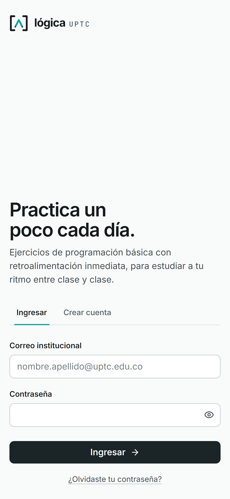

## Acceso a la plataforma

### Ingresar

1. Abre la dirección de la plataforma en tu navegador.
2. Escribe tu **correo institucional** y tu **contraseña**. El ojo al final del campo de contraseña permite verla mientras escribes.
3. Pulsa **Ingresar**. Según tu rol, llegarás a tu pantalla de inicio (estudiante), al panel docente o a la gestión de usuarios (administrador).

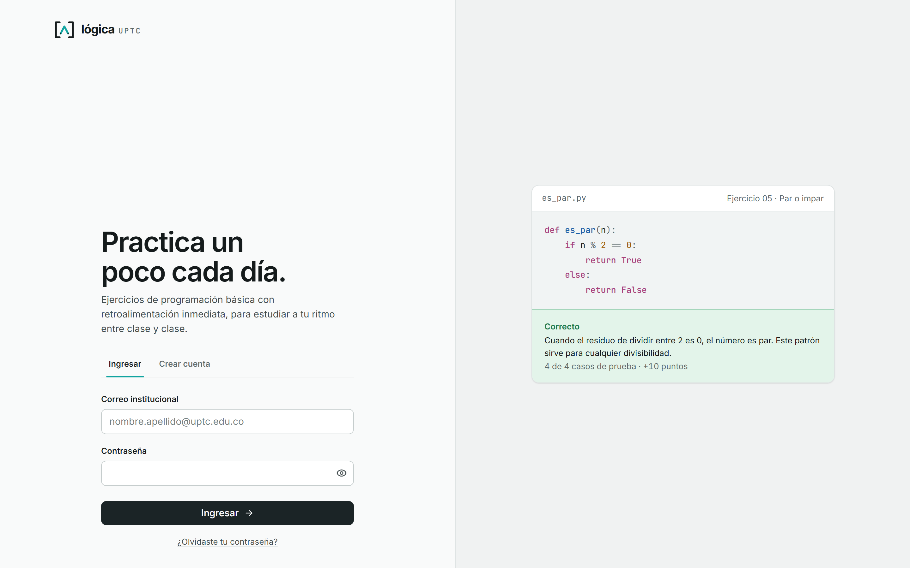

Si el correo o la contraseña no son correctos aparece el aviso «Correo o contraseña incorrectos». Revisa que no haya espacios de más ni mayúsculas activadas. Por seguridad, después de varios intentos fallidos seguidos el acceso se bloquea unos minutos.

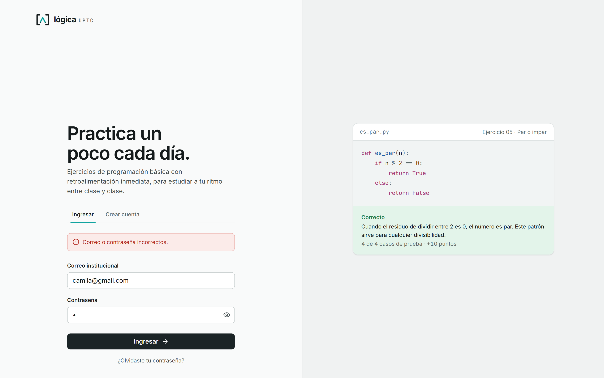

### Crear una cuenta (solo estudiantes)

1. En la pantalla de ingreso, abre la pestaña **Crear cuenta**.
2. Escribe tu **nombre completo**, tu **correo institucional** (debe terminar en `@uptc.edu.co`) y una **contraseña de al menos 8 caracteres**; repítela en **Confirmar contraseña**.
3. Pulsa **Crear cuenta**. Entras directamente a la plataforma.

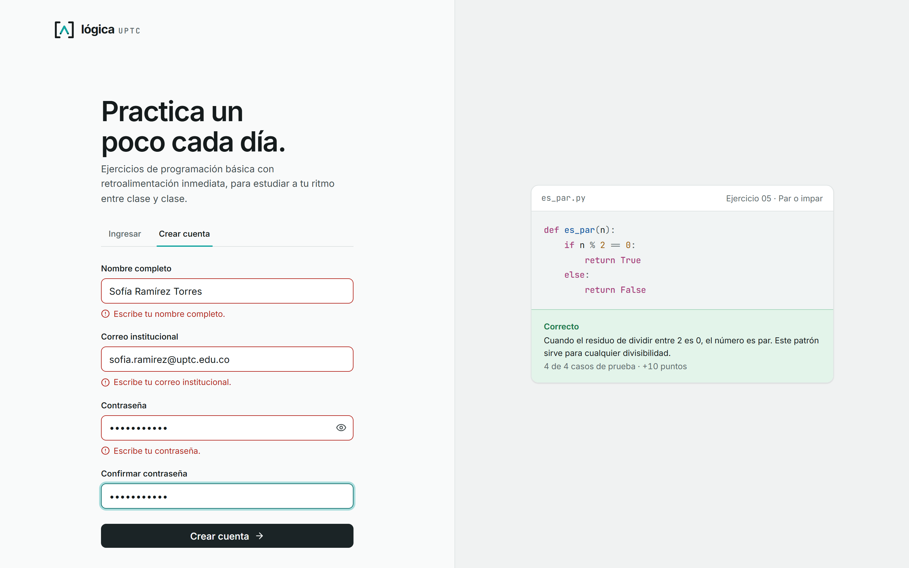

Las cuentas de **docente** y **administrador** no se crean aquí: las crea un administrador (ver «Guía para el administrador»).

### Cambiar el tema (claro u oscuro) y cerrar sesión

1. En el computador, pulsa el engranaje que está junto a tu nombre, abajo a la izquierda. En el celular, pulsa tu avatar (las iniciales), arriba a la derecha.
2. En **Tema** elige **Claro**, **Oscuro** o **Según el sistema** (sigue la configuración de tu computador o celular). La elección se recuerda.
3. Para salir, elige **Cerrar sesión**.

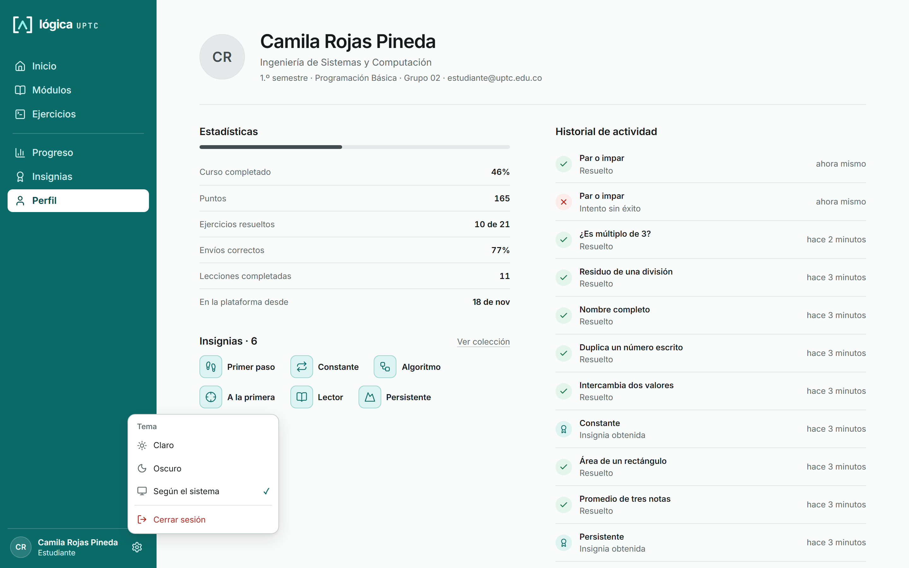

Tu sesión dura unas 8 horas y se mantiene mientras no cierres la pestaña. Si pasa ese tiempo, o tu cuenta se desactiva, la plataforma te devuelve a la pantalla de ingreso. Vuelve a ingresar.

## Guía para el estudiante

### Inicio

Al entrar ves tu pantalla de inicio: el saludo, en qué módulo vas y qué porcentaje del curso llevas.

1. En **Continuar aprendiendo** está el módulo actual con su barra de avance y el siguiente paso (una lección o un ejercicio). Pulsa **Continuar** para seguir justo donde te quedaste, o **Ver módulo** para ver todo el módulo.
2. En **Próximo ejercicio** aparece un ejercicio sugerido; pulsa **Practicar**.
3. A la derecha, **Tu avance** muestra tus puntos, el porcentaje del curso, cuántos ejercicios has resuelto y la proporción de envíos correctos. Más abajo, tus insignias recientes.
4. En **Actividad reciente** ves lo último que hiciste.

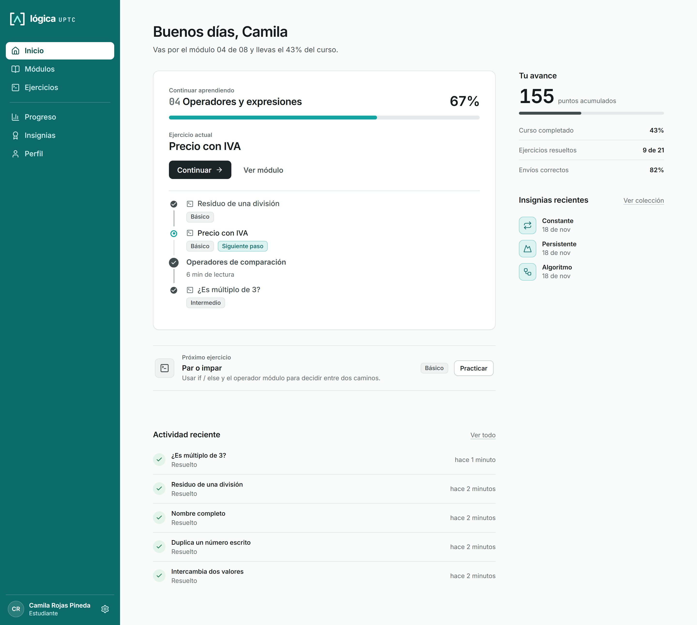

El menú de la izquierda (en el celular, la barra de abajo) te lleva a **Inicio**, **Módulos**, **Ejercicios**, **Progreso**, **Insignias** y **Perfil**.

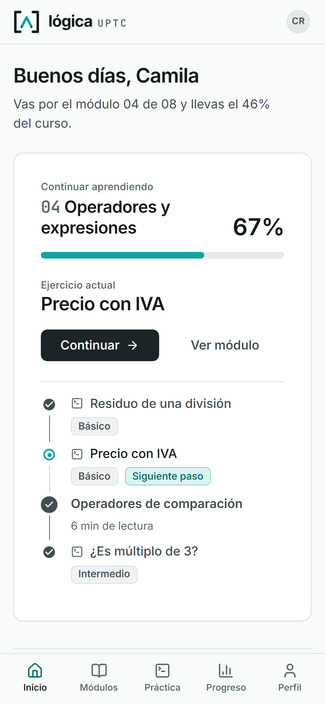

### Módulos y lecciones

El curso se divide en **ocho módulos**, del primer programa a las estructuras de datos. Cada módulo tiene lecciones (texto con ejemplos y diagramas) y ejercicios.

1. Entra a **Módulos**. Verás el módulo en que vas, los siguientes y los que ya completaste.
2. Pulsa un módulo para ver su **ruta de aprendizaje**: la lista ordenada de lecciones y ejercicios, con una marca en lo que ya hiciste.
3. Pulsa una lección para leerla. A la derecha (en el celular, en el desplegable «En esta lección») hay un índice para saltar entre secciones.
4. Al final de la lección, pulsa **Continuar al ejercicio** (o **Continuar**) para pasar a lo siguiente. **Esto marca la lección como completada.** Con **Anterior** vuelves atrás sin marcarla.

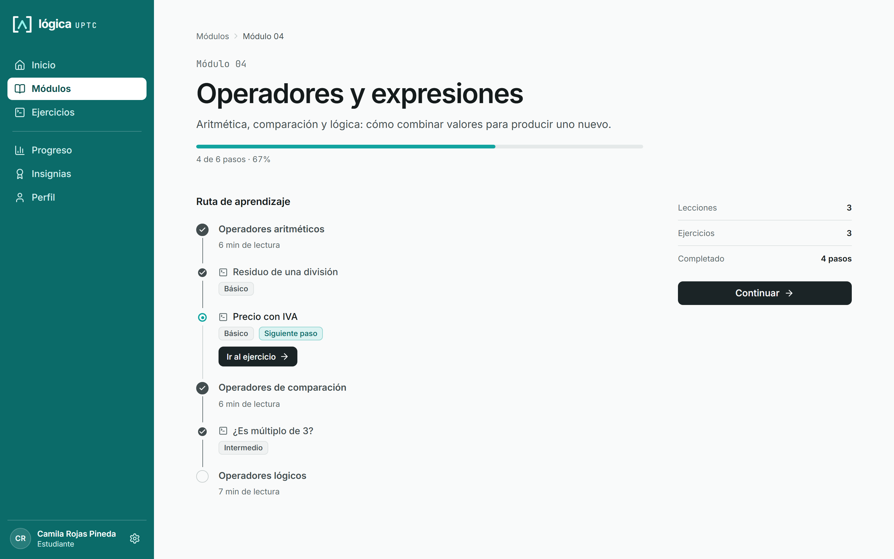

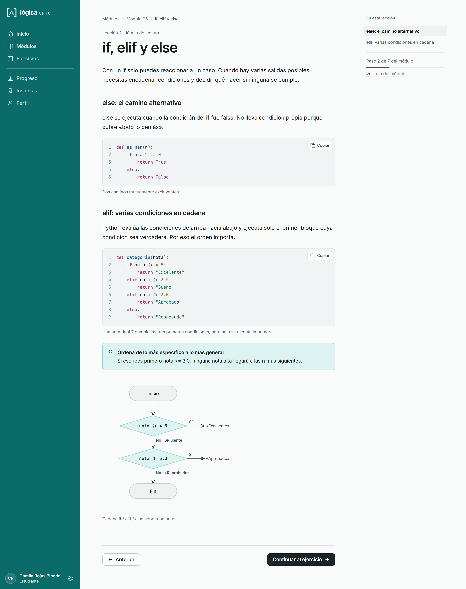

Los bloques de código de las lecciones tienen un botón **Copiar**.

### Lista de ejercicios

En **Ejercicios** están todos los ejercicios publicados, ordenados por módulo. Puedes buscar por título, filtrar por **Estado** (pendientes o resueltos) y por **Módulo**. Pulsa un ejercicio para abrirlo.

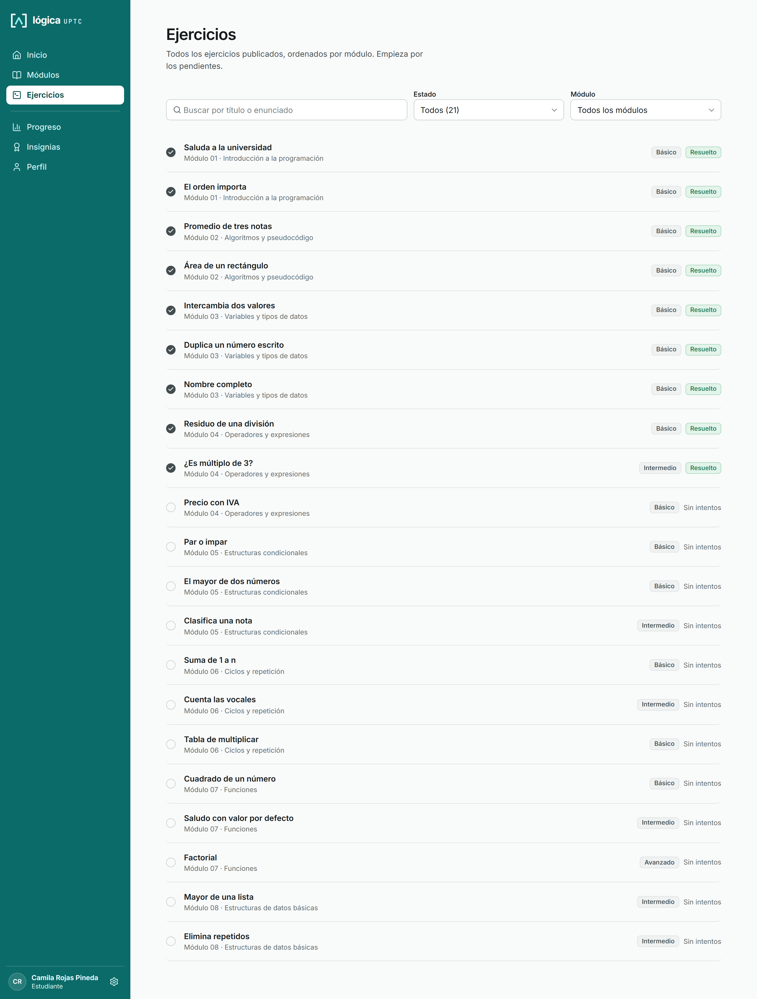

### Resolver un ejercicio

Cada ejercicio pide escribir una **función** en Python. La pantalla tiene dos partes: a la izquierda el **enunciado** (objetivo, ejemplos, restricciones y pistas) y a la derecha el **editor de código** con los **casos de prueba**.

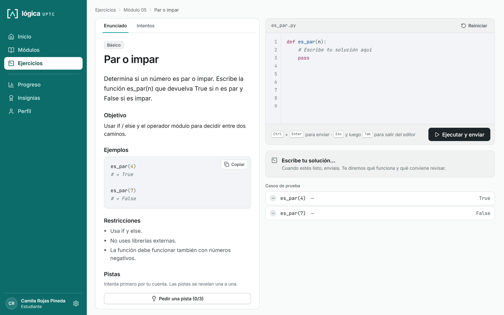

1. Lee el enunciado, los **ejemplos** y las **restricciones**. El nombre de la función (por ejemplo, `es_par`) debe respetarse.
2. Escribe tu solución en el editor. Respeta la sangría (los espacios al inicio de las líneas): en Python es parte del código. Con **Reiniciar** vuelves al código inicial. Lo que escribes se guarda como borrador en tu navegador.
3. Pulsa **Ejecutar y enviar** (o `Ctrl` + `Enter`). Para salir del editor con el teclado, pulsa `Esc` y luego `Tab`.
4. Espera unos segundos: la plataforma ejecuta tu función con los casos de prueba y muestra el resultado debajo del editor.

En el celular, usa las pestañas **Enunciado** y **Código** para pasar de una parte a otra.

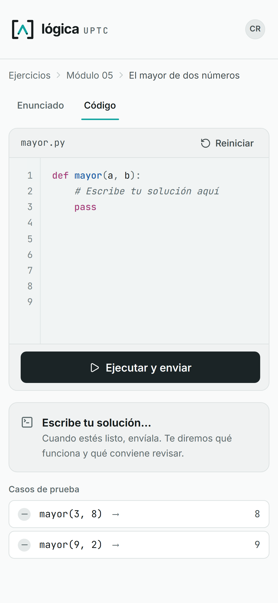

#### Interpretar la retroalimentación

- **Correcto** (verde): pasaste todos los casos. Verás los puntos ganados (+10, +20 o +30 según la dificultad), un mensaje explicativo y el botón **Siguiente ejercicio**. Si desbloqueas una insignia, aparece un aviso.
- **Hay un problema** (rojo): algún caso falló. El mensaje dice qué pasó, por ejemplo «Con es_par(4) se esperaba True, pero tu código dio False», o señala un error de escritura con el número de línea. También indica un **concepto para revisar** y un enlace a la lección relacionada.
- **Casos de prueba**: la lista de abajo marca con una palomita verde los casos que pasaron y con una cruz roja los que fallaron. Algunos casos son **ocultos**: cuentan para el resultado, pero no se muestran. Por eso un ejercicio puede fallar aunque los casos visibles pasen.
- **Tiempo agotado**: tu código tardó demasiado (a menudo, un ciclo que nunca termina). Revisa la condición del ciclo.

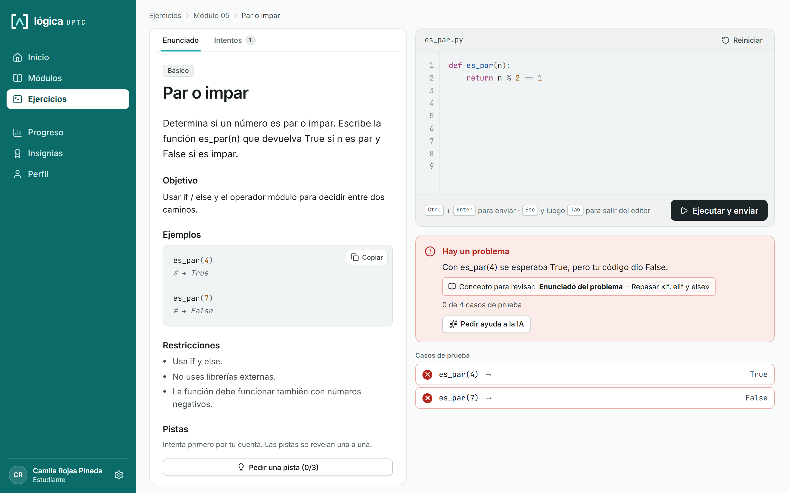

#### Pedir ayuda

Tienes dos tipos de ayuda:

- **Pistas del curso**: en el enunciado, el botón **Pedir una pista** revela una pista a la vez, de la más general a la más concreta. Úsalas con calma: si resuelves el ejercicio al primer intento y sin pistas, puedes ganar la insignia «A la primera».
- **Ayuda de la IA**: después de un intento fallido aparece el botón **Pedir ayuda a la IA**. Te da una orientación breve sobre tu último intento, **sin darte la solución**. Se marca como «Pista de la IA». Si la IA no está disponible en ese momento, verás en su lugar una «Pista del curso» con el aviso correspondiente. Puedes pedir una ayuda por cada intento fallido, hasta 10 ayudas de IA por día. La IA puede equivocarse: úsala como guía, no como respuesta.

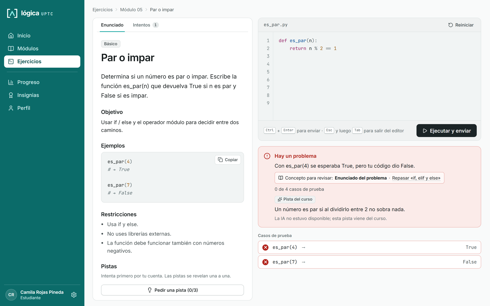

Corrige tu código y vuelve a enviarlo cuantas veces necesites (hay un límite de 10 envíos por minuto, ver «Solución de problemas»). La pestaña **Intentos** del enunciado guarda el historial de tus envíos.

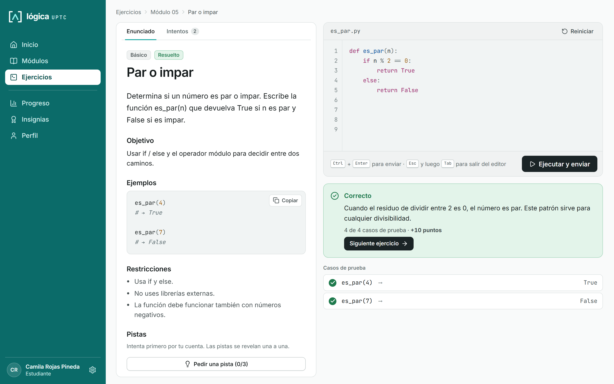

### Progreso

**Progreso** muestra tu avance general (porcentaje del curso, ejercicios completados y pendientes, tasa de éxito), el avance **por módulo** (Completado, En progreso o No iniciado) y tu actividad reciente. La tasa de éxito es la proporción de envíos correctos sobre el total de envíos.

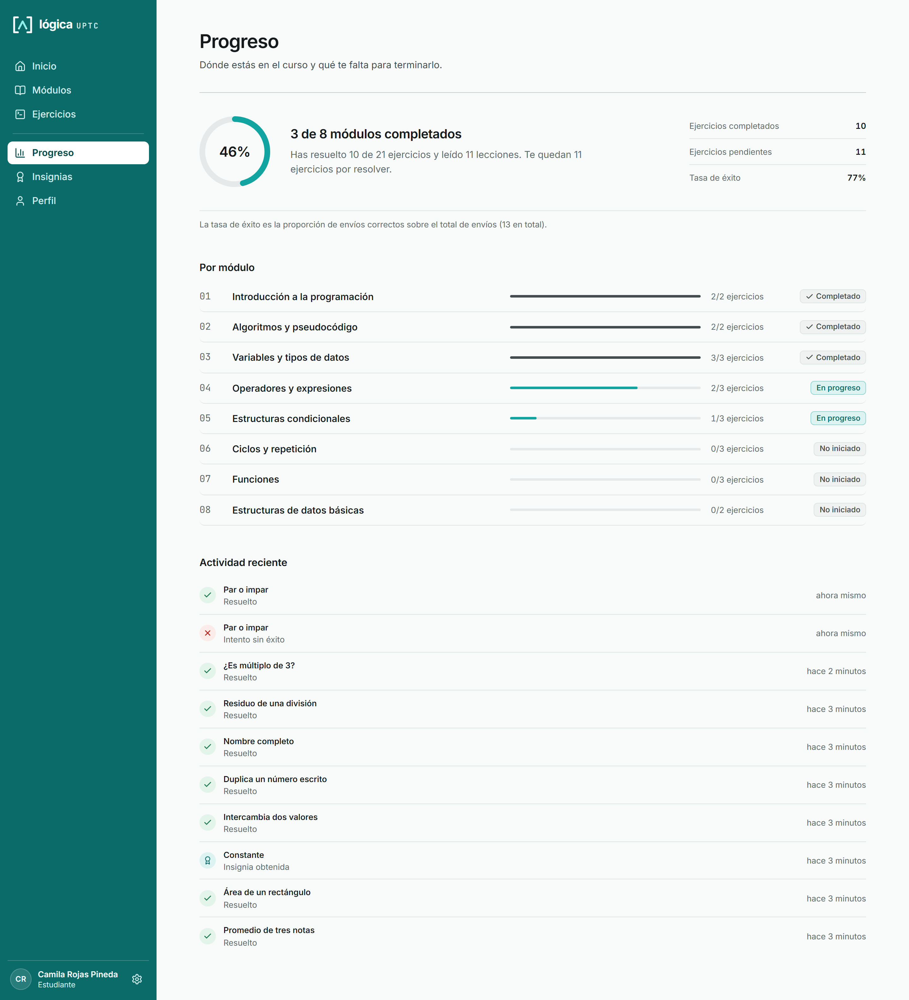

### Insignias y puntos

Las **insignias** reconocen hitos de tu práctica (por ejemplo, «Primer paso» al resolver tu primer ejercicio o «Constante» al completar 5). En **Insignias** ves las que ya obtuviste y, en **Por desbloquear**, cuánto te falta para cada una.

Los **puntos** se calculan solos: 10, 20 o 30 por cada ejercicio resuelto (según su dificultad) y 5 por cada lección completada. Un ejercicio da puntos solo la primera vez que lo resuelves.

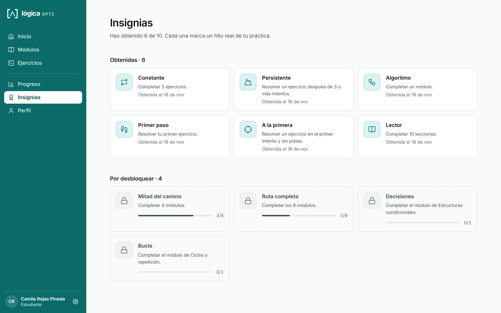

### Perfil

En **Perfil** ves tus datos (nombre, programa, semestre y grupo), tus estadísticas, las insignias y el historial completo de actividad.

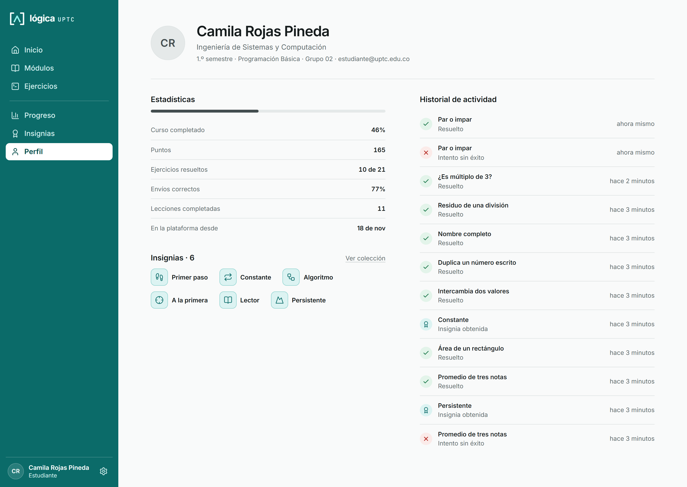

## Guía para el docente

Tu cuenta de docente la crea un administrador. Al ingresar llegas al **Panel docente**; el menú tiene **Panel**, **Contenido**, **Ejercicios** y **Reportes**.

### Panel

El panel resume a tu grupo de un vistazo:

1. **Estudiantes activos**, **Módulos publicados**, **Progreso promedio** y **Requieren atención**.
2. **Estudiantes que requieren atención**: quienes llevan 7 días o más sin actividad, o tienen un porcentaje de éxito menor al 40 % después de haber enviado intentos. Un estudiante nuevo que aún no ha enviado nada no se marca.
3. **Dónde está el grupo**: cuántos estudiantes trabajan en cada módulo.
4. **Actividad reciente** del grupo.

Pulsa **Ver reportes** para el detalle por estudiante.

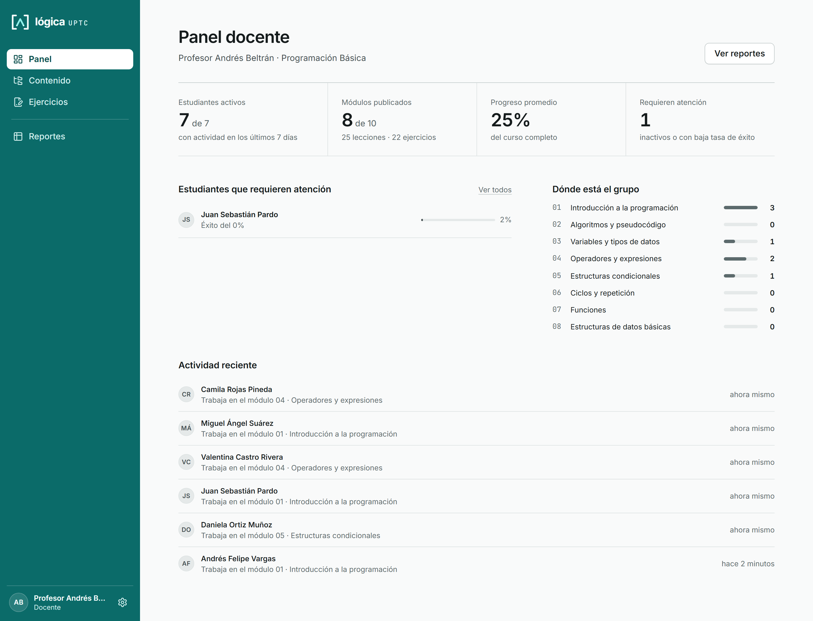

### Gestionar el contenido

En **Contenido** está todo el curso como un árbol: **módulos → lecciones → ejercicios**. Lo que no está publicado (**Borrador**) no lo ven los estudiantes.

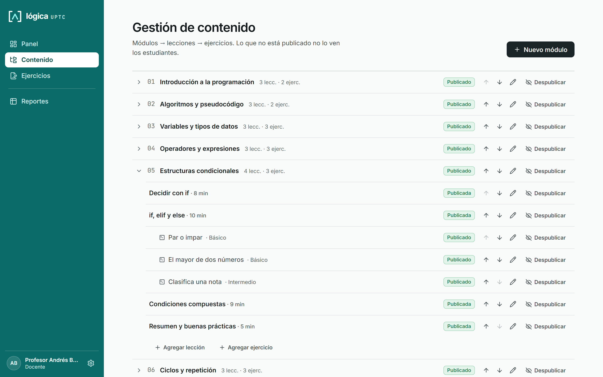

**Ver el detalle de un módulo.** Pulsa su nombre (o la flecha de la izquierda) para desplegar sus lecciones y ejercicios.

**Crear un módulo.**

1. Pulsa **Nuevo módulo**.
2. Escribe el **título** y una **descripción corta** (una o dos frases sobre lo que aprenderá el estudiante).
3. Pulsa **Guardar**. El módulo nace como **borrador**.

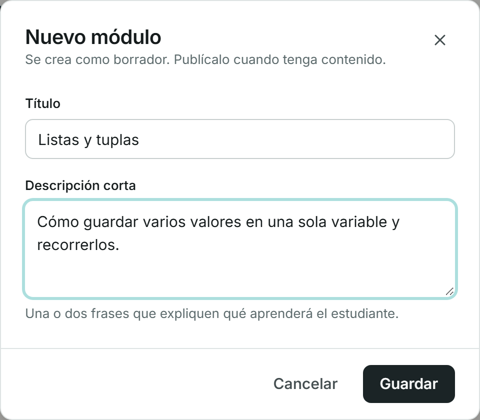

**Agregar una lección o un ejercicio.** Despliega el módulo y pulsa **Agregar lección** (título y minutos de lectura) o **Agregar ejercicio** (abre el editor de ejercicio, ver más abajo). También puedes editar el título o la descripción con el lápiz de cada fila.

> **Pendiente:** hoy, desde la pantalla solo se editan el título, la descripción y los minutos de las lecciones. El texto de la lección (párrafos, código, diagramas) se carga con los datos iniciales de la plataforma; un editor de texto para lecciones no está incluido.

**Publicar o despublicar.** Pulsa **Publicar** en la fila del módulo, la lección o el ejercicio (o **Despublicar** para retirarlo). Hay dos reglas, y si no se cumplen la plataforma lo avisa:

- un **módulo** necesita al menos una lección para publicarse;
- un **ejercicio** necesita al menos un **caso de prueba**.

Para que un estudiante vea un ejercicio, deben estar publicados el ejercicio, su lección y su módulo.

**Cambiar el orden.** Usa las flechas **Subir** y **Bajar** de cada fila: el elemento intercambia su lugar con el vecino.

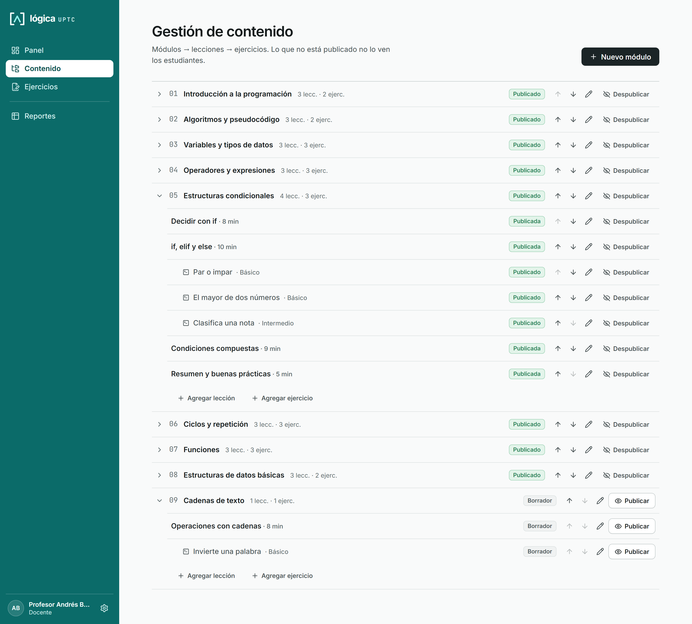

### Ejercicios y el editor de ejercicio

**Ejercicios** lista todos los ejercicios del curso. Puedes buscar por título y filtrar por módulo y estado. Pulsa **Nuevo ejercicio** para crear uno o el lápiz de un ejercicio para editarlo.

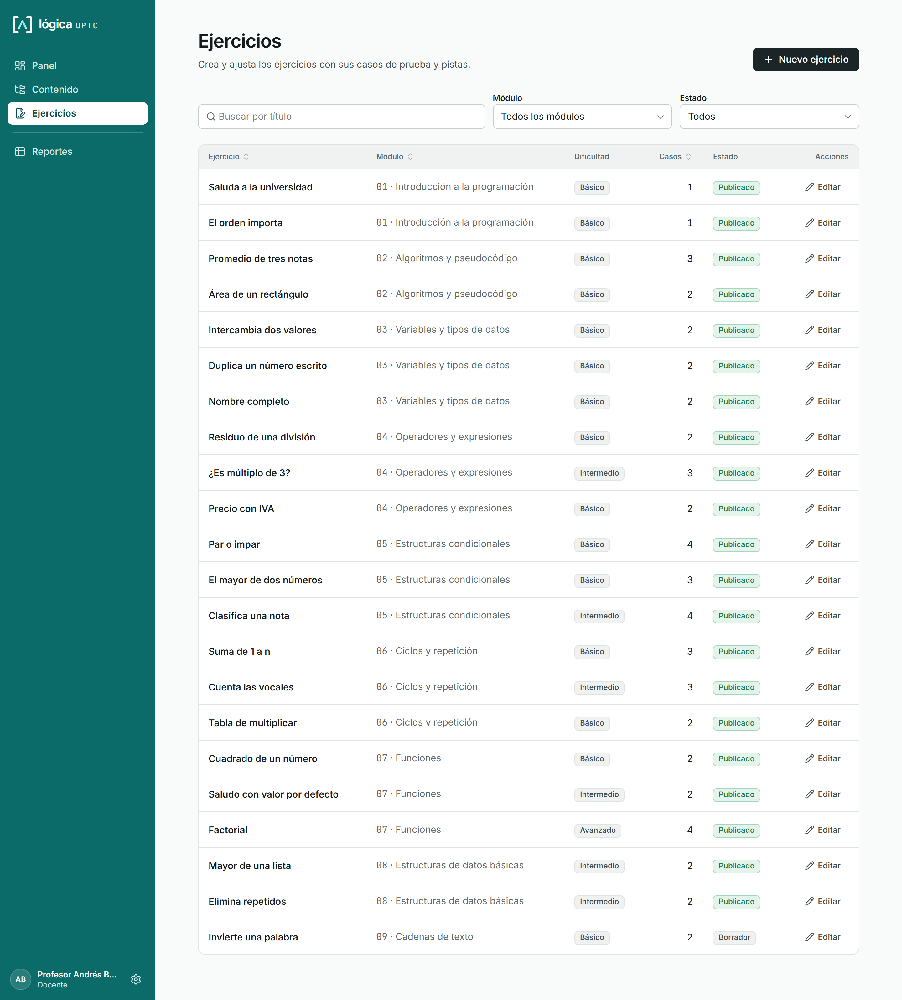

El editor tiene estas partes:

1. **Datos generales**: título, módulo, lección relacionada, dificultad (básico, intermedio o avanzado) y estado (borrador o publicado).
2. **Enunciado**: la descripción del problema y el objetivo de aprendizaje.
3. **Respuesta esperada**: una solución de referencia en Python, con su función y su `return`.
4. **Casos de prueba**: son lo que la plataforma usa para corregir. Cada caso tiene una **entrada** (una llamada a la función, por ejemplo `es_par(4)`) y el **resultado esperado** (por ejemplo `True`). Usa **Agregar caso** para añadir más y el icono de papelera para quitar uno. Conviene incluir casos límite (cero, negativos, vacíos).
5. **Pistas**: de la más general a la más concreta; el estudiante las ve una por una.
6. A la derecha, **Antes de publicar** es una lista de verificación (título y enunciado, módulo y lección, al menos un caso de prueba, respuesta esperada). Pulsa **Guardar cambios** al terminar.

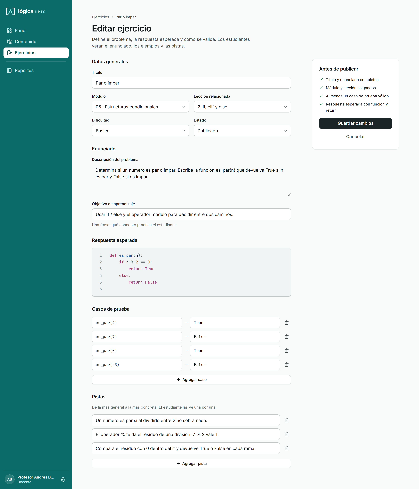

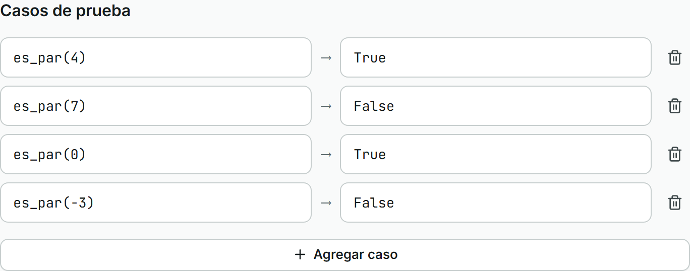

> **Nota:** un ejercicio ya creado no se puede mover a otra lección. En la lista de casos del editor se ven todos, pero al estudiante solo le llegan los **visibles**: los casos que ya eran ocultos siguen ocultos al editar, y los casos nuevos que agregues desde esta pantalla son visibles (no hay todavía un interruptor para ocultarlos).

### Reportes y exportar a CSV

En **Reportes** ves una fila por estudiante activo: su avance, los ejercicios resueltos, el porcentaje de éxito, la última actividad y su estado (**Al día** o **Requiere atención**).

1. Para encontrar a alguien, escribe en **Buscar por nombre o correo**.
2. Filtra por **Grupo** y por **Estado**.
3. Pulsa el encabezado de una columna para ordenar la tabla.
4. Pulsa **Exportar CSV** para descargar el reporte (`reporte-avance.csv`), que se abre en Excel u otra hoja de cálculo. El archivo respeta el filtro de **grupo**; el buscador y el filtro de estado solo afectan lo que ves en pantalla.

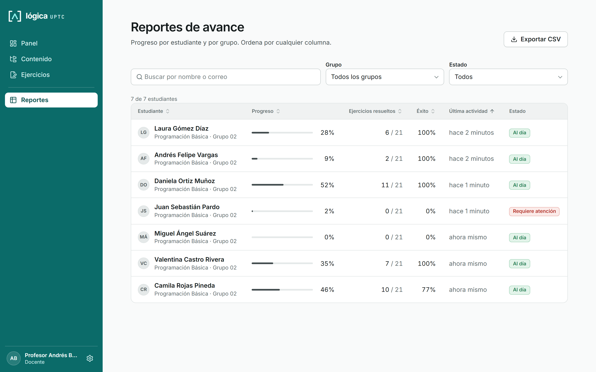

> **Nota:** si al abrir el CSV en Excel todo aparece en una sola columna, usa *Datos → Desde texto/CSV* y elige la coma como separador. Los estudiantes desactivados no aparecen en los reportes.

## Guía para el administrador

Ingresas a la pantalla **Usuarios**, donde se gestionan todas las cuentas.

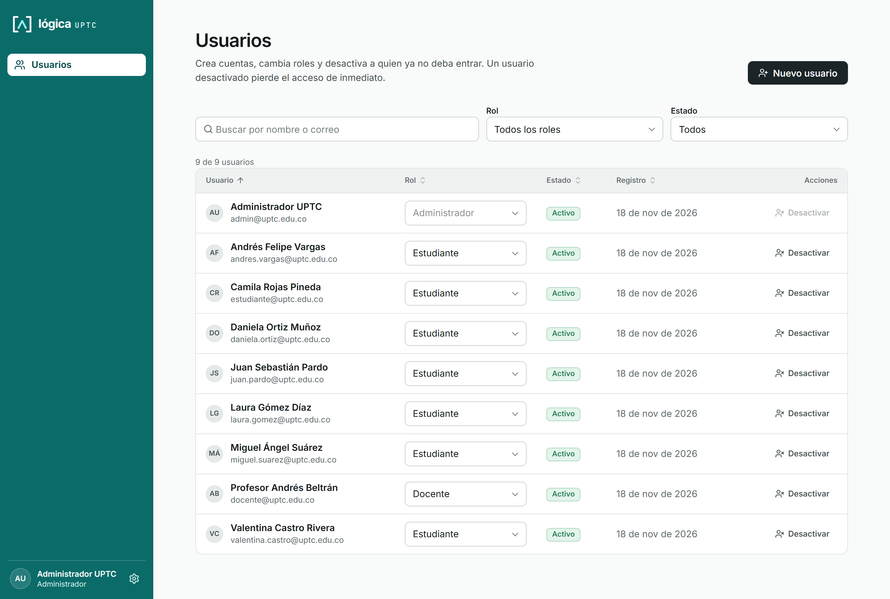

### Buscar y filtrar usuarios

Escribe un nombre o correo en **Buscar por nombre o correo** y usa los filtros **Rol** y **Estado** (activos o desactivados). Pulsa el encabezado de una columna para ordenar.

### Crear un usuario

1. Pulsa **Nuevo usuario**.
2. Completa el **nombre completo**, el **correo institucional** (`@uptc.edu.co`), la **contraseña inicial** (mínimo 8 caracteres) y el **rol** (Estudiante, Docente o Administrador).
3. Pulsa **Crear usuario**.
4. Comunica la contraseña inicial a la persona por un canal seguro.

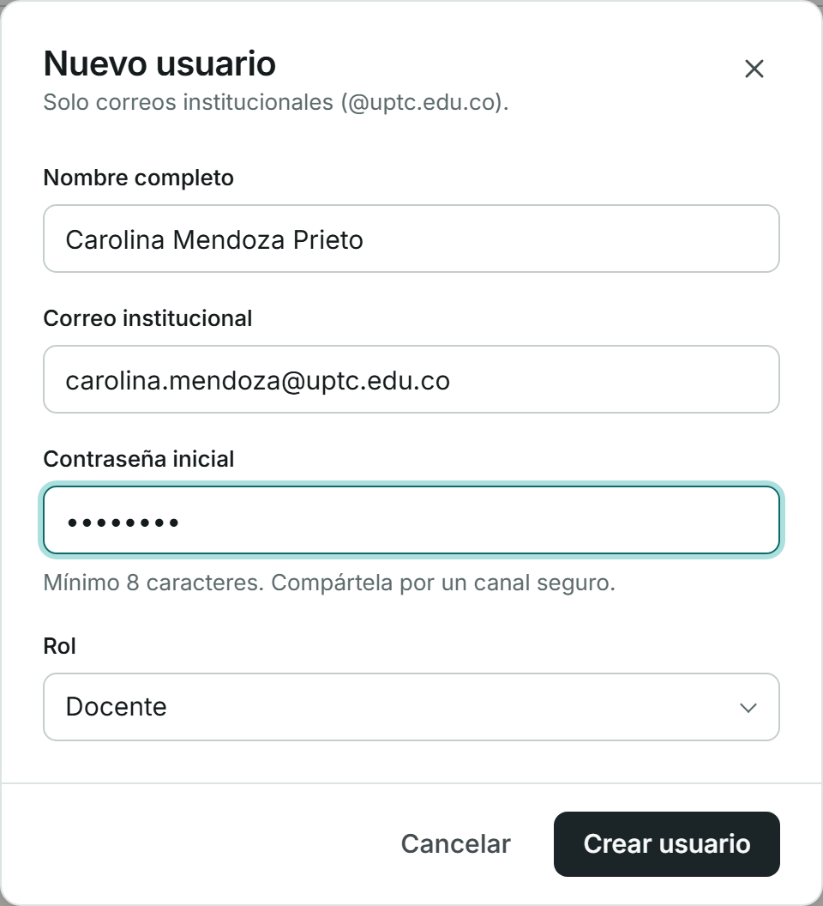

### Cambiar el rol

En la fila del usuario, abre la lista de la columna **Rol** y elige el nuevo rol. El cambio se guarda de inmediato y aparece un aviso de confirmación. No puedes cambiar tu propio rol.

### Desactivar y reactivar una cuenta

1. En la fila del usuario, pulsa **Desactivar**.
2. Confirma en la ventana que aparece. La persona pierde el acceso **de inmediato**, aunque tenga la sesión abierta. Su progreso se conserva, y deja de aparecer en los reportes del docente.
3. Para devolverle el acceso, pulsa **Activar** en su fila.

No puedes desactivar tu propia cuenta.

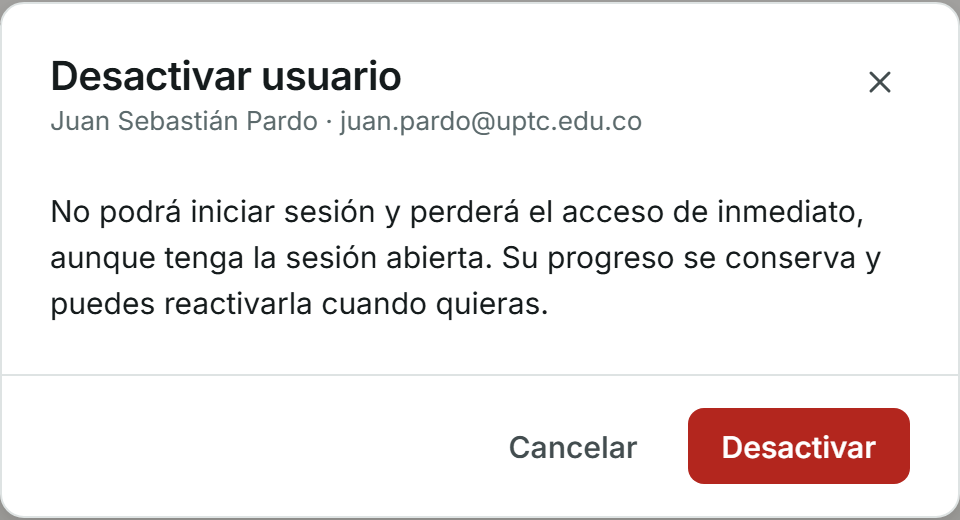

## Preguntas frecuentes

**¿Qué hago si olvidé mi contraseña?**
Hoy la plataforma no envía correos de recuperación: la pantalla de ingreso indica escribir a soporte con tu correo institucional. Un administrador puede crearte una cuenta nueva si es necesario.

> **Pendiente:** definir el canal de soporte (correo o persona de contacto) y si habrá restablecimiento de contraseña automático.

**¿Por qué no puedo crear mi cuenta?**
Solo se aceptan correos que terminen en `@uptc.edu.co` y contraseñas de al menos 8 caracteres. Si el correo ya está registrado, ingresa con él o pide ayuda al administrador.

**¿Mi código se guarda?**
Lo que escribes en el editor se guarda como borrador en tu navegador, y cada envío queda en el historial de **Intentos** del ejercicio.

**¿Por qué mi ejercicio falla si los casos que veo pasan?**
Algunos casos de prueba son ocultos. Revisa los casos límite: números negativos, cero, textos vacíos.

**¿Cuántas veces puedo enviar un ejercicio?**
Las que necesites, con un máximo de 10 envíos por minuto. Si lo superas verás «Estás enviando demasiado rápido»: espera un momento.

**¿La ayuda de la IA me da la respuesta?**
No. Orienta sobre tu último intento sin escribir la solución. Puedes pedir una por intento fallido y hasta 10 por día.

**¿Puedo usar la plataforma en el celular?**
Sí. La interfaz se adapta a pantallas pequeñas.

**¿Cuándo recibo una insignia?**
Cuando cumples su condición; aparece un aviso al enviar el ejercicio que la desbloquea y queda en **Insignias**.

## Solución de problemas

| Problema | Qué hacer |
|---|---|
| «Correo o contraseña incorrectos» | Revisa el correo y la contraseña (mayúsculas y espacios). Tras varios intentos fallidos seguidos, el acceso se bloquea unos minutos: espera e intenta de nuevo. |
| «Tu cuenta está desactivada. Contacta al administrador.» | Un administrador desactivó tu cuenta. Escríbele para que la reactive. |
| La plataforma me devolvió a la pantalla de ingreso | Tu sesión venció (dura unas 8 horas), cerraste la pestaña o tu cuenta se desactivó. Vuelve a ingresar. |
| «Estás enviando demasiado rápido» | Superaste 10 envíos en un minuto. Espera un momento y envía de nuevo. |
| «Llegaste al límite de 10 pistas con IA por hoy» | Mañana podrás pedir más. Mientras tanto usa las pistas del curso. |
| «Primero envía una solución…» al pedir ayuda de IA | La ayuda se basa en tu último intento fallido: envía tu solución primero. |
| El mensaje de la IA dice «Pista del curso» | La IA no estuvo disponible en ese momento; se muestra una pista fija del ejercicio. Puedes seguir normalmente. |
| «El servicio de corrección no está disponible por ahora» | El corrector está fuera de servicio. Tu intento no se guarda; intenta de nuevo en unos minutos y avisa a tu docente si persiste. |
| «Tiempo agotado» | Tu programa tardó más de 3 segundos. Busca ciclos que no terminan o trabajo innecesario. |
| La página se ve rara o no carga | Recarga con `Ctrl` + `F5`. Comprueba tu conexión y que el navegador esté actualizado. |
| No puedo publicar un ejercicio o un módulo (docente) | Un ejercicio necesita al menos un caso de prueba y un módulo, al menos una lección. El aviso en pantalla indica cuál falta. |
| El CSV se abre en una sola columna (docente) | En Excel usa *Datos → Desde texto/CSV* y elige la coma como separador. |
| Otro problema | Escribe a soporte con tu correo institucional y una descripción (o captura) de lo que ves. |

> **Pendiente:** completar el dato de contacto de soporte.
